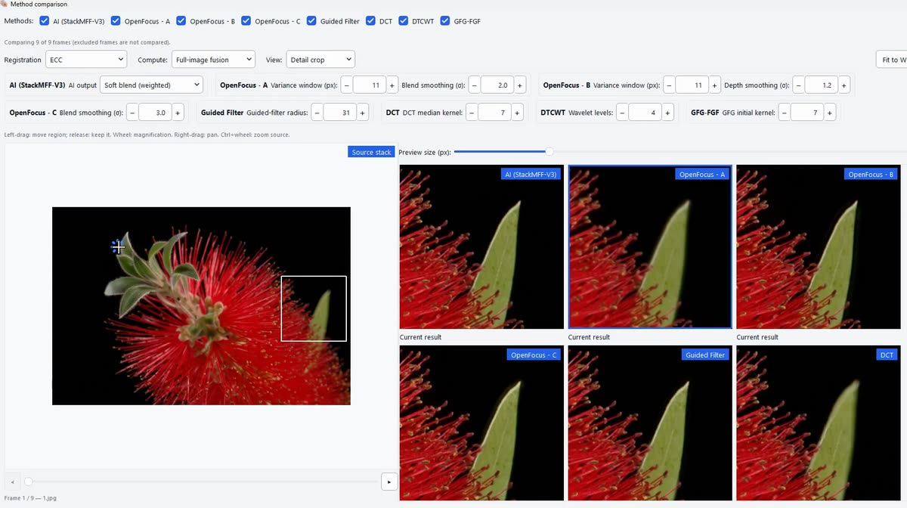

<p align="center">
  <a href="https://github.com/Xinzhe99/OpenFocus">
    
  </a>
</p>

<h1 align="center">OpenFocus</h1>

<p align="center"><strong>Jede Schärfeebene. Ein durchgehend scharfes Bild.</strong></p>

<p align="center">
  Acht Fusionsverfahren, drei Registrierungsmodi und eine quellengebundene Retusche für Makro-, Mikroskopie- und Industriestapel. 16 Bit durchgängig, eine Headless-CLI und eine Oberfläche in zwölf Sprachen.
</p>

<p align="center">
  <a href="https://github.com/Xinzhe99/OpenFocus/releases"></a>
  <a href="https://github.com/Xinzhe99/OpenFocus/stargazers"></a>
  <a href="./LICENSE"></a>
  
</p>

<p align="center">
  
  
  
  <a href="https://pypi.org/project/openfocus/"></a>
</p>

<p align="center">
  <a href="#install">Download</a> ·
  <a href="./docs/USER_MANUAL_DE.md">Dokumentation</a> ·
  <a href="./CHANGELOG.md">Änderungen</a> ·
  <a href="https://doi.org/10.5281/zenodo.23050823">DOI</a>
</p>

<p align="center">
  <a href="README.md">English</a> ·
  <a href="README.zh-CN.md">简体中文</a> ·
  <a href="README.ja.md">日本語</a> ·
  <a href="README.es.md">Español</a> ·
  <strong>Deutsch</strong> ·
  <a href="README.fr.md">Français</a> ·
  <a href="README.ru.md">Русский</a> ·
  <a href="README.ko.md">한국어</a> ·
  <a href="README.pt.md">Português</a> ·
  <a href="README.it.md">Italiano</a> ·
  <a href="README.nl.md">Nederlands</a> ·
  <a href="README.pl.md">Polski</a>
</p>

<p align="center">
  
</p>

## 📢 News

> [!NOTE]
> **v1.68.1** — der Batch-Export folgt dem gewählten Modus: Nur-Ausrichten erzeugt einen `<Stapel>_aligned`-Ordner und listet ihn, Fusion listet nur das fused Bild, und ohne Ausrichtungs-Export wird nur dieses geschrieben. Übrig gebliebene `*_registered*`-Kopien im Quellordner werden nicht mehr als Frames geladen. Ebenfalls überarbeitet: Labels, Maßstabsbalken, Methodenvergleich, Tiefen-/Modellexport, Updates und Retusche gemäß dem Audit in `docs/ux-specs`.

<a id="features"></a>
## Funktionen

<table>

<tr>
<td width="46%" valign="middle">

### KI-Fusion: StackMFF V3

Das Standardverfahren ordnet jeden Pixel per neuronalem Netz dem wahrscheinlichsten Quellbild zu. Auf demselben registrierten Stapel bleiben Buchstabenkanten schärfer und Flächen sauberer als mit Guided Filter (Laplace-Schärfe 27,1 zu 28,5); gegen synthetische Ground Truth führt es bei PSNR und SSIM und hinterlässt weniger Geisterpixel als jedes klassische Verfahren.

[StackMFF V3 →](https://github.com/Xinzhe99/StackMFF-V3) · [Benchmark →](tools/synthetic_benchmark.py)

</td>
<td width="54%">

<a href="assets/readme/ai.mp4"><picture><source srcset="assets/readme/ai.gif" type="image/gif"></picture></a>

</td>
</tr>

<tr>
<td width="46%" valign="middle">

### A/B-Wipe

Ziehen Sie den Trenner über Quellbild und Ergebnis: Sie sehen sofort, was die Fusion verändert hat — Registrierungsdrift, Ränder mit Halos und verlorene Details, in jeder Zoomstufe.

[Handbuch →](./docs/USER_MANUAL_DE.md)

</td>
<td width="54%">

<a href="assets/readme/wipe.mp4"><picture><source srcset="assets/readme/wipe.gif" type="image/gif"></picture></a>

</td>
</tr>

<tr>
<td width="46%" valign="middle">

### Methodenvergleich

Alle Verfahren einmal rendern, nebeneinander am gleichen Ausschnitt prüfen und den Gewinner als neues Ergebnis übernehmen oder seine Parameter ins Hauptfenster zurückschreiben.

</td>
<td width="54%">

<a href="assets/readme/compare.mp4"><picture><source srcset="assets/readme/compare.gif" type="image/gif"></picture></a>

</td>
</tr>

<tr>
<td width="46%" valign="middle">

### Tiefenkarte &amp; 3D

Fokusposition pro Pixel aus fünf Fokusmaßen, wissenschaftliche Farbskalen, physikalische Z-Kalibrierung aus TIFF-Metadaten und texturierter OBJ-Export der Oberfläche.

</td>
<td width="54%">

<a href="assets/readme/depth.mp4"><picture><source srcset="assets/readme/depth.gif" type="image/gif"></picture></a>

</td>
</tr>

<tr>
<td width="46%" valign="middle">

### Quellengebundene Retusche

Malen aus den Bildern, die das Ergebnis tatsächlich erzeugt haben: gemeinsamer Zoom und Verschiebung, Quellbild-Regler, weicher Pinsel, Wiederherstellungspinsel, Undo pro Strich und Schutz nicht exportierter Pixel.

</td>
<td width="54%">

<a href="assets/readme/retouch.mp4"><picture><source srcset="assets/readme/retouch.gif" type="image/gif"></picture></a>

</td>
</tr>

<tr>
<td width="46%" valign="middle">

### Stapelverarbeitung

Auf einen Ordner voller Stapel zeigen, Verfahren und Ziel wählen, laufen lassen. Nur-Ausrichten schreibt einen Ordner pro Stapel; Fusion schreibt und listet ausschließlich das fused Bild.

</td>
<td width="54%">

<a href="assets/readme/batch.mp4"><picture><source srcset="assets/readme/batch.gif" type="image/gif"></picture></a>

</td>
</tr>

<tr>
<td width="46%" valign="middle">

### Publikations-Maßstabsbalken

Aus TIFF-Metadaten oder manuell kalibriert, mit echter Schrift und echter Länge gezeichnet und in jeden Export eingebrannt — Einzelbild, Stapel, TIFF, GIF und Batch. Passt sie nicht lesbar hinein, sagt das Dialogfeld das, statt einen kürzeren Balken mit falscher Beschriftung zu zeichnen.

[Handbuch →](./docs/USER_MANUAL_DE.md)

</td>
<td width="54%">

<a href="assets/readme/scalebar.mp4"><picture><source srcset="assets/readme/scalebar.gif" type="image/gif"></picture></a>

</td>
</tr>

<tr>
<td width="46%" valign="middle">

### Beschriftungen und Legenden

Beschriftungen bleiben eine verwaltete Liste: jede mit eigenem Geltungsbereich (Quelle, ausgerichteter Stapel oder ein bestimmtes Ergebnis), Bildbereich und Stil. Vorschau und jeder Export nutzen dasselbe Ziel und dieselbe Bildnummer, sodass `{value}` in Speichern, Speichern unter, Herausziehen und Alles exportieren identisch liest.

</td>
<td width="54%">

<a href="assets/readme/labels.mp4"><picture><source srcset="assets/readme/labels.gif" type="image/gif"></picture></a>

</td>
</tr>
</table>

**Außerdem enthalten:**

- **Focus-Stacking-Workflow** — Stack-Browser, Schärfekurve, Schnellvorschau, ROI-Render und pro Verfahren gemerkte Einstellungen über Neustarts hinweg.
- **Mikroskopiebereit** — 16 Bit durchgängig, µm/px aus TIFF, Flat-Field-Korrektur, mehrseitige TIFF-Z-Stacks.
- **Headless-CLI** — dieselbe Pipeline als `openfocus`, mit Batch, `--dry-run`, `--resume` und JSON-Ausgabe.
- **Projekte und Wiederherstellung** — `.ofproj`-Sitzungen, automatische Absturzrettung, Undo/Redo für Stapel und Beschriftungen.
- **Zwölf UI-Sprachen** — English, 简体中文, 日本語, Español, Deutsch, Français, Русский, 한국어, Português, Italiano, Nederlands, Polski; automatisch aus dem System erkannt, eine neue Sprache ist eine `locales_<code>.py`-Datei.
- **Speicherschonend** — die neuronalen Gewichte werden nur beim AI-Verfahren geladen; eine klassische Sitzung ruht bei rund 110 MB statt 260 MB.

<a id="install"></a>
## ⬇️ Installation

Keine Einrichtung nötig — Build von der [Releases](https://github.com/Xinzhe99/OpenFocus/releases)-Seite laden:

| Plattform | Datei | Typ |
|-----------|-------|-----|
| Windows 10/11 (64 Bit) | `OpenFocus-*-setup.exe` | **Installer** (empfohlen) |
| Windows 10/11 (64 Bit) | `OpenFocus-*-windows-x64.zip` | Portabel (entpacken und starten) |
| macOS Apple Silicon (M1–M4) | `OpenFocus-*-macos.dmg` | Disk-Image (in „Programme“ ziehen) |
| macOS Apple Silicon (M1–M4) | `OpenFocus-*-macos-arm64.zip` | Portabel (entpacken) |

Die App ist nicht signiert, daher kann der erste Start einen Sicherheitshinweis zeigen: **Windows** SmartScreen → „Weitere Informationen“ → „Trotzdem ausführen“ (der erste Start kann 30–60 s dauern); **macOS** Rechtsklick → Öffnen, oder `xattr -cr /Applications/OpenFocus.app` im Terminal.

### 💻 Kommandozeile

Alternativ die CLI unter Windows, macOS und Linux installieren — dieselbe Pipeline, ohne GUI-Stack:

```bash
pip install openfocus
openfocus -i ./stack_folder -o ./result/fused.png
```

KI-Modell, Gewichte, HEIC- und Kamera-RAW-Dekodierung stecken in dieser einen Installation. Unter Python 3.13+ entfällt `dtcwt`, dort bleibt der DTCWT-Eintrag mit Erklärung deaktiviert.

<a id="community"></a>
## Community & Support

- **Dokumentation** — [Handbuch](./docs/USER_MANUAL_DE.md) (zwölf Sprachen) · [Änderungen](./CHANGELOG.md) · [Performance](./docs/PERFORMANCE.md) · [Algorithmus-Parität](./docs/ALGORITHM_PARITY.md)
- **Zitation** — [CITATION.cff](./CITATION.cff); jede Version wird auf Zenodo archiviert ([DOI](https://doi.org/10.5281/zenodo.23050823))
- **Feedback** — [Issue](https://github.com/Xinzhe99/OpenFocus/issues) für Fehler, Ideen und Algorithmusarbeit
- **Danksagung** — jedes Fusions-/Registrierungsverfahren behält seine ursprüngliche Forschungslizenz; StackMFF V3 liegt unter [Xinzhe99/StackMFF-V3](https://github.com/Xinzhe99/StackMFF-V3)

<a id="developing"></a>
## Entwicklung

Aus dem Checkout starten:

```bash
conda create -n openfocus python=3.10
conda activate openfocus
pip install -r requirements.txt
python main.py
```

Paketierung mit PyInstaller: [docs/BUILD_COMMANDS.md](./docs/BUILD_COMMANDS.md).

<a id="star-history"></a>
## ⭐ Star-Verlauf

[](https://star-history.com/#Xinzhe99/OpenFocus&Date)
