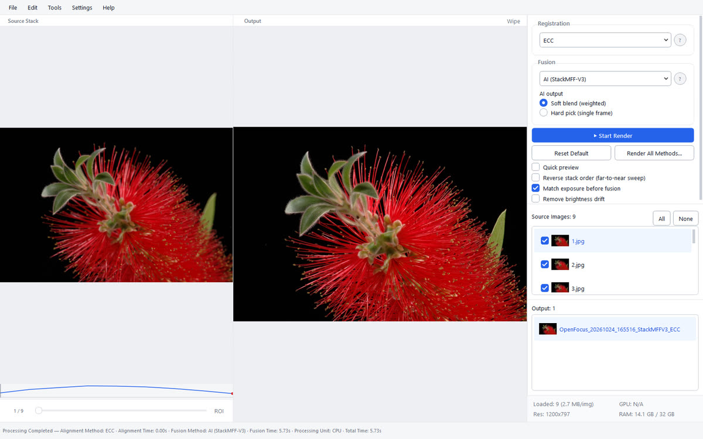
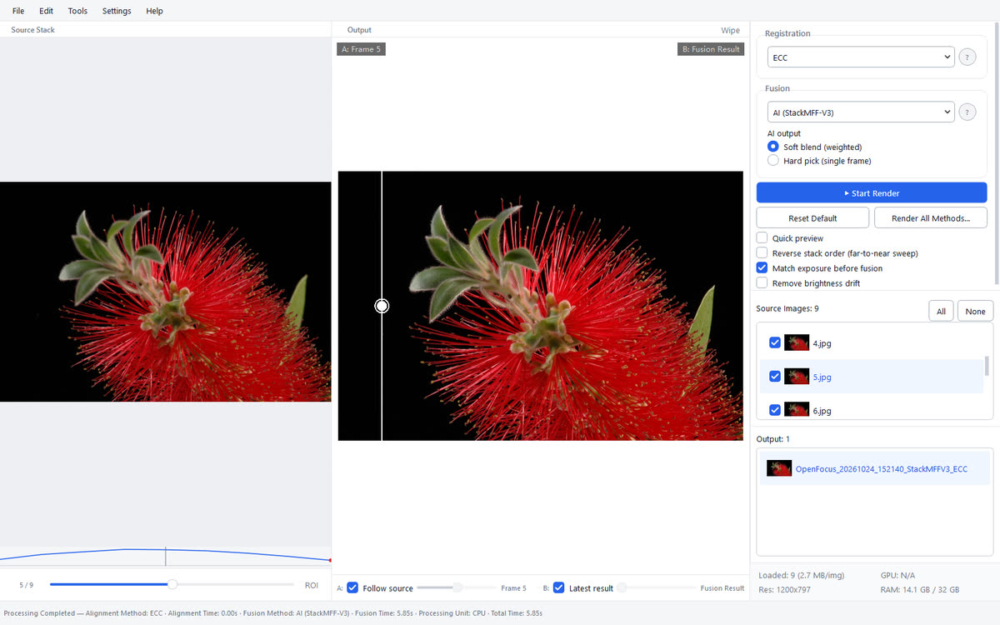
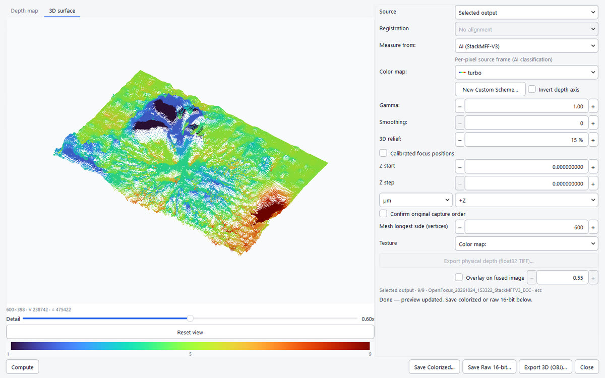
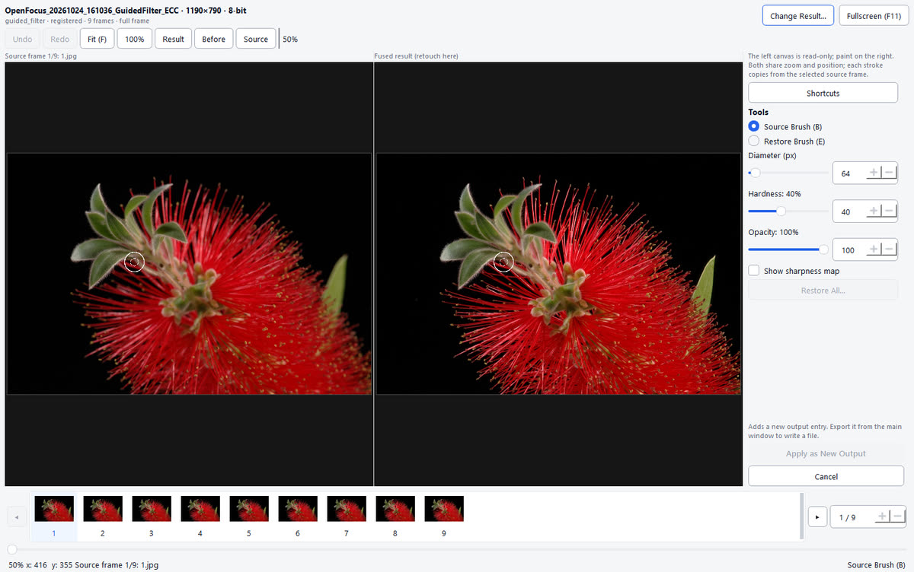
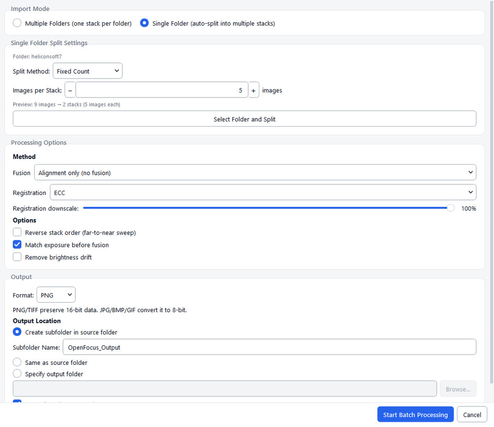
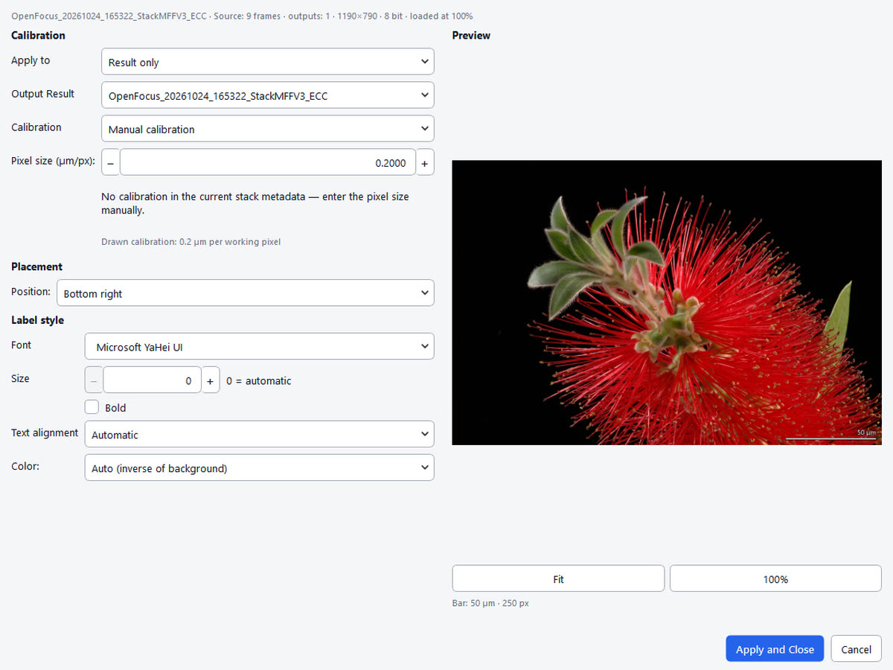
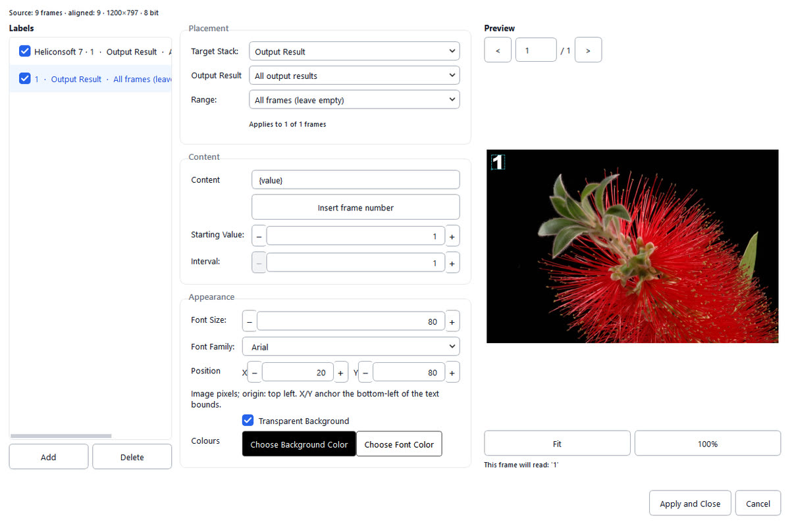

<p align="center">
  <a href="https://github.com/Xinzhe99/OpenFocus">
    
  </a>
</p>

<h1 align="center">OpenFocus</h1>

<p align="center"><strong>Todos los planos de enfoque. Una imagen totalmente nítida.</strong></p>

<p align="center">
  Ocho algoritmos de fusión, tres modos de registro y un espacio de retoque ligado a la fuente para macro, microscopía e imágenes industriales. 16 bits de extremo a extremo, CLI sin interfaz y una UI en doce idiomas.
</p>

<p align="center">
  <a href="https://github.com/Xinzhe99/OpenFocus/releases"></a>
  <a href="https://github.com/Xinzhe99/OpenFocus/stargazers"></a>
  <a href="./LICENSE"></a>
  
</p>

<p align="center">
  
  
  
  <a href="https://pypi.org/project/openfocus/"></a>
</p>

<p align="center">
  <a href="#install">Descargar</a> ·
  <a href="./docs/USER_MANUAL_ES.md">Documentación</a> ·
  <a href="./CHANGELOG.md">Cambios</a> ·
  <a href="https://doi.org/10.5281/zenodo.23050823">DOI</a>
</p>

<p align="center">
  <a href="README.md">English</a> ·
  <a href="README.zh-CN.md">简体中文</a> ·
  <a href="README.ja.md">日本語</a> ·
  <strong>Español</strong> ·
  <a href="README.de.md">Deutsch</a> ·
  <a href="README.fr.md">Français</a> ·
  <a href="README.ru.md">Русский</a> ·
  <a href="README.ko.md">한국어</a> ·
  <a href="README.pt.md">Português</a> ·
  <a href="README.it.md">Italiano</a> ·
  <a href="README.nl.md">Nederlands</a> ·
  <a href="README.pl.md">Polski</a>
</p>

<p align="center">
  
</p>

## 📢 News

> [!NOTE]
> **v1.71.0** — los algoritmos se declaran ahora en un registro inmutable: un nuevo método de fusión o registro aparece en renderizado, lote, comparación, profundidad y CLI con un solo descriptor y parámetros tipados. Cada inicio escribe su propio registro rotativo con identificadores de tarea enlazados, parámetros, tiempos y trazas completas; el ZIP de comentarios incluye el informe de fallo, datos de RAM/GPU y versiones de dependencias. El diagnóstico arranca antes de importar Qt o las librerías numéricas, así que un fallo de inicio también queda registrado. Los ocho algoritmos siguen idénticos byte a byte a v1.70.0.

<a id="features"></a>
## Funciones

<table>

<tr>
<td width="46%" valign="middle">

### Fusión con IA: StackMFF V3

El método predeterminado clasifica cada píxel según su fotograma de origen más probable con una red neuronal. En la misma pila registrada mantiene los bordes de las letras más nítidos y las superficies más limpias que Guided Filter (nitidez laplaciana 27,1 frente a 28,5), y lidera todos los métodos en PSNR y SSIM frente a una verdad sintética, con menos píxeles fantasma que cualquier algoritmo clásico.

[StackMFF V3 →](https://github.com/Xinzhe99/StackMFF-V3) · [Banco de pruebas →](tools/synthetic_benchmark.py)

</td>
<td width="54%">

<a href="assets/readme/ai.mp4"><picture><source srcset="assets/readme/ai.gif" type="image/gif"></picture></a>

</td>
</tr>

<tr>
<td width="46%" valign="middle">

### Comparación A/B

Arrastra el divisor entre un fotograma y el resultado fusionado para ver qué cambió la mezcla: deriva de registro, halos en los bordes y detalle perdido, a cualquier zoom.

[Manual →](./docs/USER_MANUAL_ES.md)

</td>
<td width="54%">

<a href="assets/readme/wipe.mp4"><picture><source srcset="assets/readme/wipe.gif" type="image/gif"></picture></a>

</td>
</tr>

<tr>
<td width="46%" valign="middle">

### Comparación de métodos

Renderiza todos los métodos una vez, compáralos lado a lado en el mismo recorte y adopta el ganador como nueva salida o copia sus parámetros a la ventana principal.

</td>
<td width="54%">

<a href="assets/readme/method-comparison.mp4"><picture><source srcset="assets/readme/method-comparison.gif" type="image/gif"></picture></a>

</td>
</tr>

<tr>
<td width="46%" valign="middle">

### Mapa de profundidad y 3D

Posición de foco por píxel con cinco medidas, mapas de color científicos, calibración Z física desde metadatos TIFF y exportación OBJ texturizada.

</td>
<td width="54%">

<a href="assets/readme/depth.mp4"><picture><source srcset="assets/readme/depth.gif" type="image/gif"></picture></a>

</td>
</tr>

<tr>
<td width="46%" valign="middle">

### Retoque ligado a la fuente

Pinta desde los fotogramas que produjeron el resultado: zoom y desplazamiento compartidos, control de fotograma, pincel suave, pincel de restauración, deshacer por trazo y protección de píxeles sin exportar.

</td>
<td width="54%">

<a href="assets/readme/retouch.mp4"><picture><source srcset="assets/readme/retouch.gif" type="image/gif"></picture></a>

</td>
</tr>

<tr>
<td width="46%" valign="middle">

### Procesamiento por lotes

Apunta a una carpeta de pilas, elige método y destino, y déjalo trabajar. Solo alineación escribe una carpeta por pila; la fusión escribe y lista solo la imagen fusionada.

</td>
<td width="54%">

<a href="assets/readme/batch.mp4"><picture><source srcset="assets/readme/batch.gif" type="image/gif"></picture></a>

</td>
</tr>

<tr>
<td width="46%" valign="middle">

### Barras de escala de publicación

Calibradas desde metadatos TIFF o a mano, dibujadas con la fuente y longitud reales, e incrustadas en cada exportación: imagen, pila, TIFF, GIF y lote. Si no cabe de forma legible lo indica, en lugar de dibujar una barra que no coincide con su etiqueta.

[Manual →](./docs/USER_MANUAL_ES.md)

</td>
<td width="54%">

<a href="assets/readme/scalebar.mp4"><picture><source srcset="assets/readme/scalebar.gif" type="image/gif"></picture></a>

</td>
</tr>

<tr>
<td width="46%" valign="middle">

### Etiquetas y leyendas

Mantén las leyendas como una lista gestionada: cada una con su ámbito (fuente, pila alineada o una salida concreta), rango de fotogramas y estilo. La vista previa y todas las exportaciones usan el mismo destino y número de fotograma, así que `{value}` se lee igual en Guardar, Guardar como, arrastrar y Exportar todo.

</td>
<td width="54%">

<a href="assets/readme/labels.mp4"><picture><source srcset="assets/readme/labels.gif" type="image/gif"></picture></a>

</td>
</tr>
</table>

**También incluye:**

- **Flujo de focus stacking**——explorador de pilas, curva de nitidez, vista previa rápida, render ROI y ajustes por método recordados entre sesiones.
- **Listo para microscopía**——16 bits de extremo a extremo, µm/px desde TIFF, corrección de campo plano, Z-stacks TIFF multipágina.
- **CLI sin interfaz**——la misma tubería como `openfocus`, con lotes, `--dry-run`, `--resume` y salida JSON.
- **Proyectos y recuperación**——sesiones `.ofproj`, recuperación tras fallos y deshacer/rehacer de ediciones y anotaciones.
- **Doce idiomas de interfaz**——English, 简体中文, 日本語, Español, Deutsch, Français, Русский, 한국어, Português, Italiano, Nederlands, Polski; detectados del sistema, un idioma nuevo es un archivo `locales_<code>.py`.
- **Ligero en memoria**——los pesos neuronales se cargan solo al usar el método AI, así que una sesión clásica ronda 110 MB en vez de 260 MB.

<a id="install"></a>
## ⬇️ Instalación

Sin configuración: descarga una compilación desde [Releases](https://github.com/Xinzhe99/OpenFocus/releases):

| Plataforma | Archivo | Tipo |
|------------|---------|------|
| Windows 10/11 (64 bits) | `OpenFocus-*-setup.exe` | **Instalador** (recomendado) |
| Windows 10/11 (64 bits) | `OpenFocus-*-windows-x64.zip` | Portable (descomprimir y ejecutar) |
| macOS Apple Silicon (M1–M4) | `OpenFocus-*-macos.dmg` | Imagen de disco (arrastrar a Aplicaciones) |
| macOS Apple Silicon (M1–M4) | `OpenFocus-*-macos-arm64.zip` | Portable (descomprimir) |

La aplicación no está firmada, así que el primer inicio puede mostrar un aviso: **Windows** SmartScreen → «Más información» → «Ejecutar de todas formas» (el primer arranque puede tardar 30–60 s); **macOS** clic derecho → Abrir, o `xattr -cr /Applications/OpenFocus.app` en Terminal.

### 💻 Línea de comandos

También puedes instalar la CLI en Windows, macOS y Linux: la misma tubería, sin pila gráfica:

```bash
pip install openfocus
openfocus -i ./stack_folder -o ./result/fused.png
```

El modelo de IA, sus pesos, la decodificación HEIC y RAW de cámara están en esa única instalación. En Python 3.13+ se omite `dtcwt` y la entrada DTCWT queda deshabilitada con una explicación.

<a id="community"></a>
## Comunidad y soporte

- **Documentación** — [Manual](./docs/USER_MANUAL_ES.md) (doce idiomas) · [Cambios](./CHANGELOG.md) · [Rendimiento](./docs/PERFORMANCE.md) · [Paridad de algoritmos](./docs/ALGORITHM_PARITY.md)
- **Citación** — [CITATION.cff](./CITATION.cff); cada versión se archiva en Zenodo ([DOI](https://doi.org/10.5281/zenodo.23050823))
- **Comentarios** — abre un [issue](https://github.com/Xinzhe99/OpenFocus/issues) para fallos, ideas y mejoras de algoritmos
- **Créditos** — cada algoritmo de fusión y registro conserva su licencia de investigación original; StackMFF V3 está en [Xinzhe99/StackMFF-V3](https://github.com/Xinzhe99/StackMFF-V3)

<a id="developing"></a>
## Desarrollo

Ejecutar desde el repositorio:

```bash
conda create -n openfocus python=3.10
conda activate openfocus
pip install -r requirements.txt
python main.py
```

Empaquetado con PyInstaller: [docs/BUILD_COMMANDS.md](./docs/BUILD_COMMANDS.md).

<a id="star-history"></a>
## ⭐ Historial de estrellas

[](https://star-history.com/#Xinzhe99/OpenFocus&Date)
