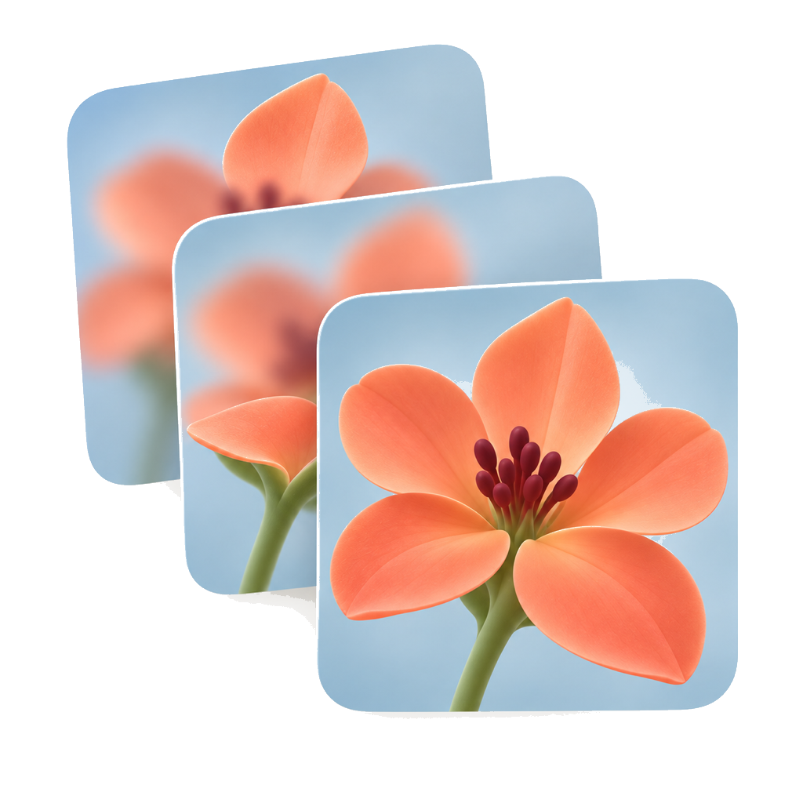
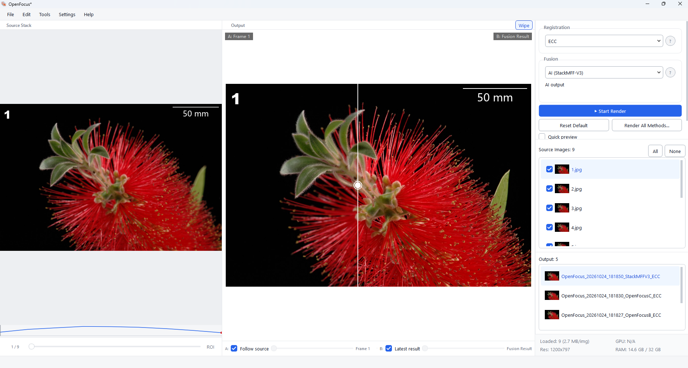
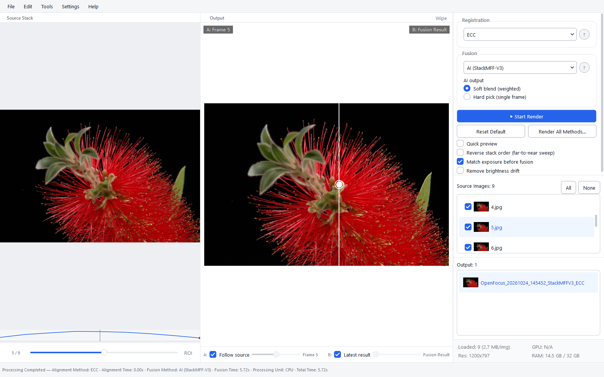
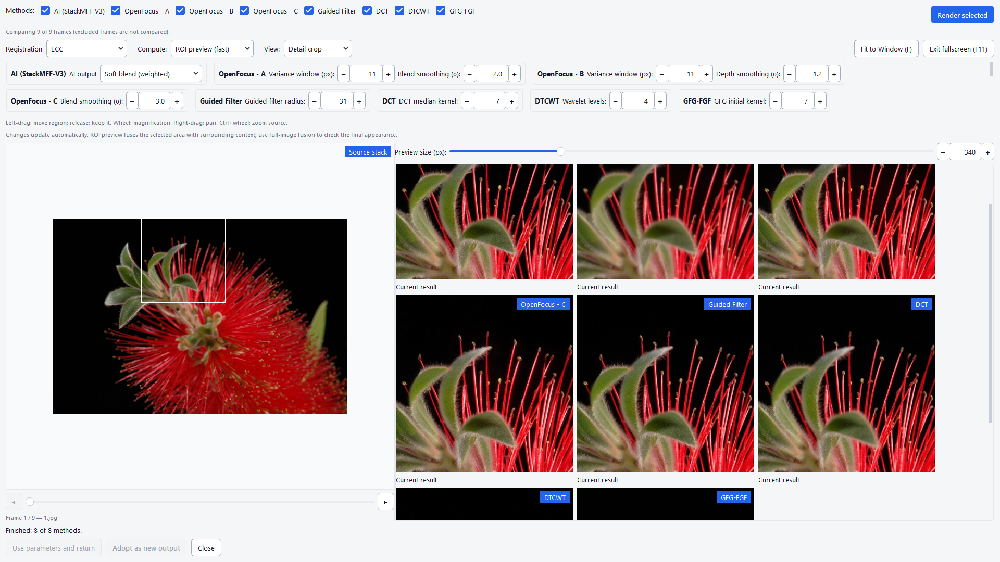
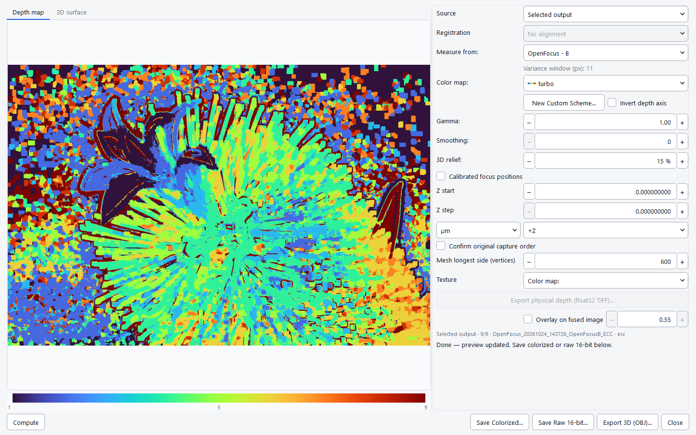
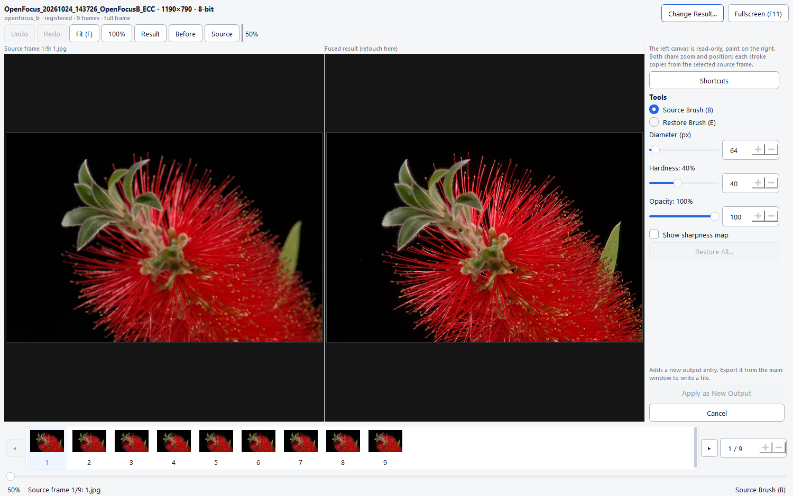
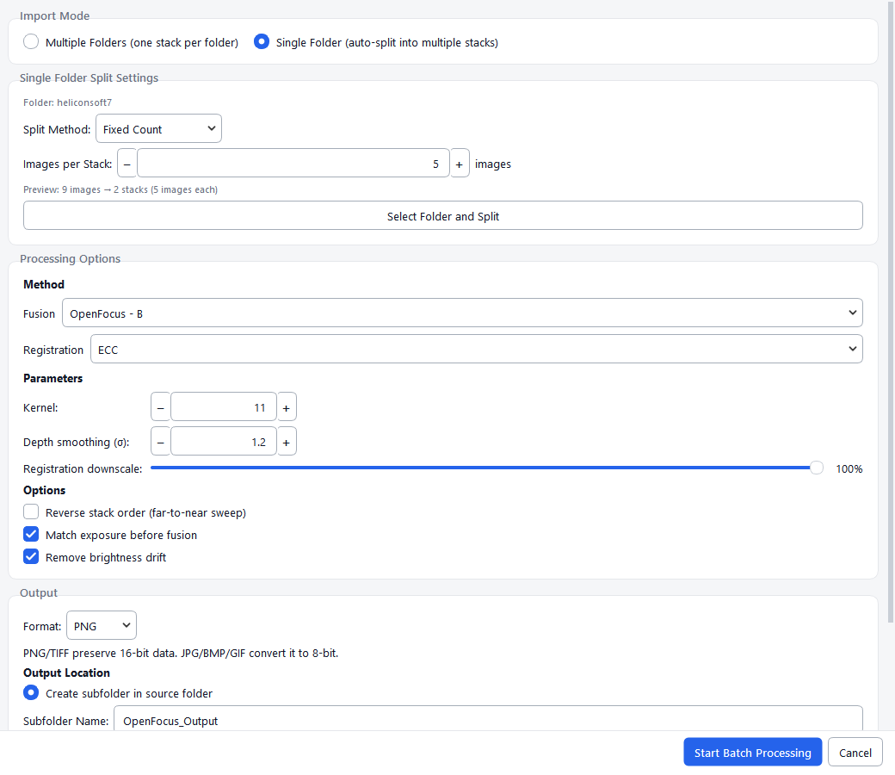
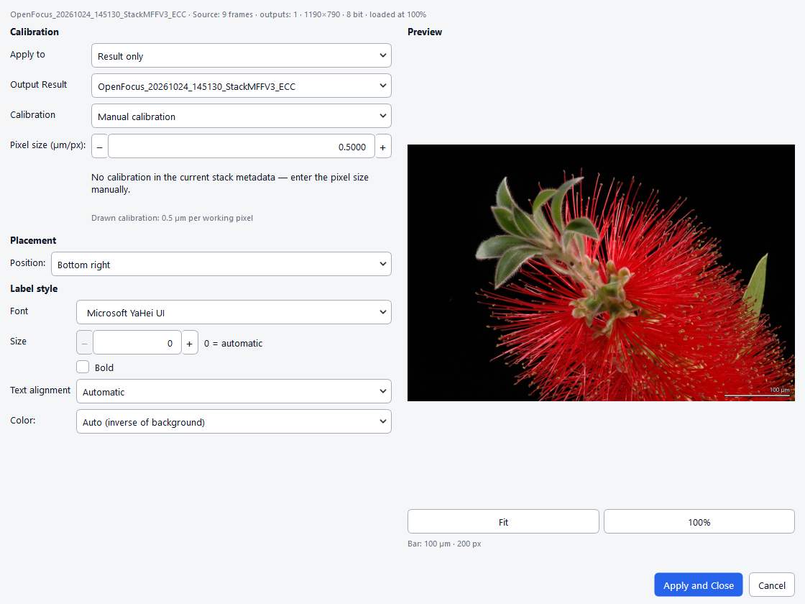
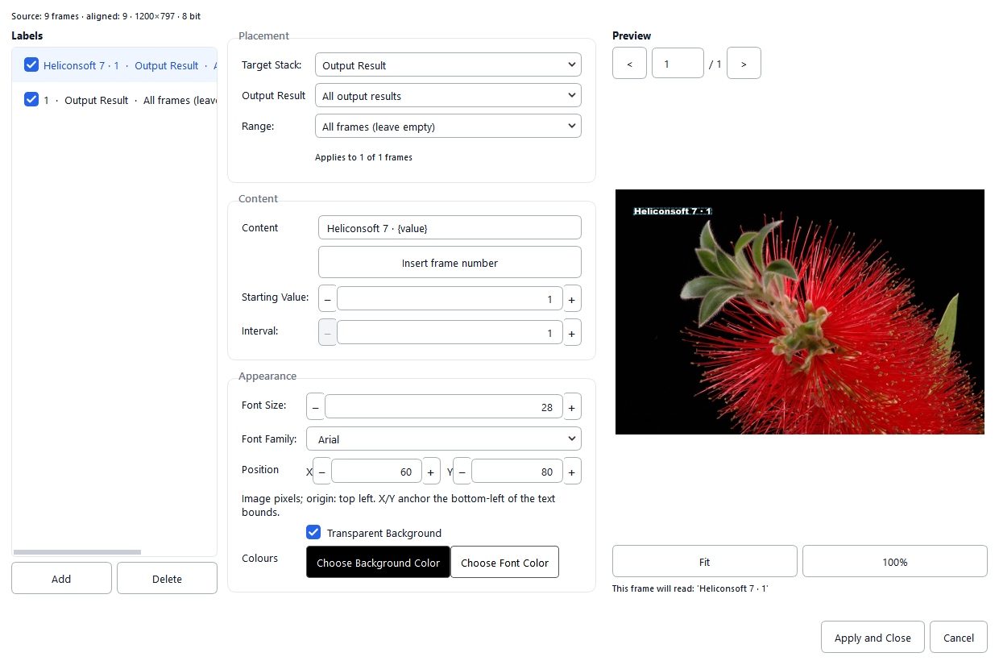

<p align="center">
  <a href="https://github.com/Xinzhe99/OpenFocus">
    
  </a>
</p>

<h1 align="center">OpenFocus</h1>

<p align="center"><strong>Tous les plans de mise au point. Une seule image nette partout.</strong></p>

<p align="center">
  Huit algorithmes de fusion, trois modes de recalage et un espace de retouche lié à la source pour la macro, la microscopie et les piles industrielles. 16 bits de bout en bout, une CLI sans interface et une UI en douze langues.
</p>

<p align="center">
  <a href="https://github.com/Xinzhe99/OpenFocus/releases"></a>
  <a href="https://github.com/Xinzhe99/OpenFocus/stargazers"></a>
  <a href="./LICENSE"></a>
  
</p>

<p align="center">
  
  
  
  <a href="https://pypi.org/project/openfocus/"></a>
</p>

<p align="center">
  <a href="#download">Télécharger</a> ·
  <a href="./docs/USER_MANUAL_FR.md">Documentation</a> ·
  <a href="#command-line-usage">CLI</a> ·
  <a href="./CHANGELOG.md">Journal</a> ·
  <a href="https://doi.org/10.5281/zenodo.23050823">DOI</a>
</p>

<p align="center">
  <a href="README.md">English</a> ·
  <a href="README.zh-CN.md">简体中文</a> ·
  <a href="README.ja.md">日本語</a> ·
  <a href="README.es.md">Español</a> ·
  <a href="README.de.md">Deutsch</a> ·
  <strong>Français</strong> ·
  <a href="README.ru.md">Русский</a> ·
  <a href="README.ko.md">한국어</a> ·
  <a href="README.pt.md">Português</a> ·
  <a href="README.it.md">Italiano</a> ·
  <a href="README.nl.md">Nederlands</a> ·
  <a href="README.pl.md">Polski</a>
</p>

<p align="center">
  
</p>

## 📢 News

> [!NOTE]
> **v1.68.1** — l'export par lots suit le mode choisi : l'alignement seul crée un dossier `<pile>_aligned` et l'affiche, la fusion n'affiche que l'image fusionnée, et sans export de l'alignement seule cette image est écrite. Les copies `*_registered*` restées dans le dossier source ne sont plus chargées comme images. Retouche également des libellés, barres d'échelle, comparaison de méthodes, export de profondeur/modèle, mises à jour et retouche d'après l'audit `docs/ux-specs`.

<a id="features"></a>
## Fonctionnalités

<table>

<tr>
<td width="46%" valign="middle">

### Fusion IA : StackMFF V3

La méthode par défaut classe chaque pixel selon son image source la plus probable via un réseau de neurones. Sur la même pile recalée, les contours des lettres restent plus nets et les surfaces plus propres qu'avec Guided Filter (netteté laplacienne 27,1 contre 28,5) ; face à une vérité synthétique, elle devance toutes les méthodes en PSNR et SSIM, avec moins de pixels fantômes que tout algorithme classique.

[Algorithmes →](#algorithms) · [Benchmark →](tools/synthetic_benchmark.py)

</td>
<td width="54%">


</td>
</tr>

<tr>
<td width="46%" valign="middle">

### Comparaison A/B

Faites glisser le séparateur entre une image source et le résultat : vous voyez immédiatement ce que la fusion a changé — dérive de recalage, halos sur les bords et détail perdu, à tout zoom.

[Manuel →](./docs/USER_MANUAL_FR.md)

</td>
<td width="54%">



</td>
</tr>

<tr>
<td width="46%" valign="middle">

### Comparaison de méthodes

Rendez toutes les méthodes une fois, comparez-les côte à côte sur le même recadrage, puis adoptez la gagnante comme nouvelle sortie ou copiez ses paramètres dans la fenêtre principale.

</td>
<td width="54%">



</td>
</tr>

<tr>
<td width="46%" valign="middle">

### Carte de profondeur et 3D

Position de mise au point par pixel via cinq mesures, palettes scientifiques, calibration Z physique depuis les métadonnées TIFF et export OBJ texturé de la surface.

</td>
<td width="54%">



</td>
</tr>

<tr>
<td width="46%" valign="middle">

### Retouche liée à la source

Peignez depuis les images qui ont réellement produit le résultat : zoom et déplacement partagés, curseur d'image source, pinceau doux, pinceau de restauration, annulation par trait et protection des pixels non exportés.

</td>
<td width="54%">



</td>
</tr>

<tr>
<td width="46%" valign="middle">

### Traitement par lots

Pointez un dossier de piles, choisissez méthode et destination, puis laissez tourner. L'alignement seul écrit un dossier par pile ; la fusion n'écrit et n'affiche que l'image fusionnée.

</td>
<td width="54%">



</td>
</tr>

<tr>
<td width="46%" valign="middle">

### Barres d'échelle de publication

Calibrées depuis les métadonnées TIFF ou saisies à la main, dessinées avec la police et la longueur réelles, et gravées dans chaque export : image, pile, TIFF, GIF et lot. Si elle ne peut pas être lisible, le dialogue le signale au lieu de dessiner une barre plus courte que son étiquette.

[Manuel →](./docs/USER_MANUAL_FR.md)

</td>
<td width="54%">



</td>
</tr>

<tr>
<td width="46%" valign="middle">

### Libellés et légendes

Les légendes forment une liste gérée : chacune a sa portée (source, pile recalée ou sortie précise), sa plage d'images et son style. L'aperçu et tous les exports utilisent la même cible et le même numéro d'image, donc `{value}` se lit de la même façon dans Enregistrer, Enregistrer sous, le glisser-déposer et Tout exporter.

</td>
<td width="54%">



</td>
</tr>
</table>

**Également inclus :**

- **Flux de focus stacking** — navigateur de piles, courbe de netteté, aperçu rapide, rendu ROI et réglages par méthode mémorisés entre sessions.
- **Prêt pour la microscopie** — 16 bits de bout en bout, µm/px depuis TIFF, correction de champ plat, Z-stacks TIFF multipages.
- **CLI sans interface** — la même chaîne que `openfocus`, avec lots, `--dry-run`, `--resume` et sortie JSON.
- **Projets et récupération** — sessions `.ofproj`, récupération après plantage, annuler/rétablir sur les piles et les annotations.
- **Douze langues d'interface** — English, 简体中文, 日本語, Español, Deutsch, Français, Русский, 한국어, Português, Italiano, Nederlands, Polski ; détectées du système, une nouvelle langue est un fichier `locales_<code>.py`.
- **Économe en mémoire** — les poids neuronaux ne se chargent qu'avec la méthode AI ; une session classique reste autour de 110 Mo au lieu de 260 Mo.

<a id="download"></a>
## Téléchargement et installation

Téléchargez une version depuis [Releases](https://github.com/Xinzhe99/OpenFocus/releases) :

| Plateforme | Fichier | Type |
|------------|---------|------|
| Windows 10/11 (64 bits) | `OpenFocus-*-setup.exe` | **Installateur** (recommandé) |
| Windows 10/11 (64 bits) | `OpenFocus-*-windows-x64.zip` | Portable (décompresser et lancer) |
| macOS Apple Silicon (M1–M4) | `OpenFocus-*-macos.dmg` | Image disque (glisser dans Applications) |
| macOS Apple Silicon (M1–M4) | `OpenFocus-*-macos-arm64.zip` | Portable (décompresser) |

L’application n’est pas signée : au premier lancement, Windows peut demander « Informations complémentaires → Exécuter quand même » ; sur macOS, clic droit → Ouvrir, ou `xattr -cr /Applications/OpenFocus.app`.

## Démarrage rapide

```bash
# CLI complète : toutes les méthodes, modèle IA, HEIC et RAW appareil photo
pip install openfocus

# Fusionner un dossier d’images
openfocus -i ./stack_folder -o ./result/fused.png

# DTCWT avec recalage ECC et 8 threads
openfocus -i ./stack_folder -o ./result/fused.png -m dtcwt -a ecc -t 8
```

Lancer l’interface depuis les sources :

```bash
conda create -n openfocus python=3.10
conda activate openfocus
pip install -r requirements.txt
python main.py
```

## Documentation

- [Manuel utilisateur (français)](./docs/USER_MANUAL_FR.md)
- [Journal des modifications](./CHANGELOG.md)
- [Performances et grandes piles](./docs/PERFORMANCE.md)
- [Commandes de compilation](./docs/BUILD_COMMANDS.md)
- [Parité des algorithmes](./docs/ALGORITHM_PARITY.md)

La référence complète en anglais se trouve dans [README.md](./README.md).

## Citation et licence

Si OpenFocus vous aide dans vos travaux, citez le projet via [CITATION.cff](./CITATION.cff).

Le projet est distribué sous [licence MIT](./LICENSE). Chaque algorithme de fusion/recalage conserve également sa licence d’origine.
