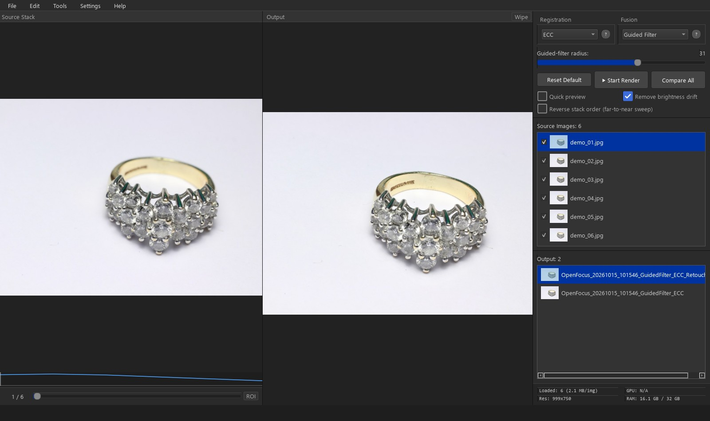

#  OpenFocus

OpenFocus delivers focus stacking quality that rivals commercial-grade software, while staying fully open source and easy to extend.

<p align="left">
  <a href="https://www.python.org/downloads/release/python-3100/"></a>
  <a href="./LICENSE"></a>
  <a href="https://github.com/Xinzhe99/OpenFocus"></a>
  <a href="https://github.com/Xinzhe99/OpenFocus/releases"></a>
  <a href="https://doi.org/10.5281/zenodo.23050823"></a>
</p>

## 📢 News

> [!NOTE]
> **2026.10.15 · v1.52–v1.53 — retouch brush & a quality pass.** New **Retouch** tool (`Ctrl+T`): paint pixels from a source frame onto the result to fix halos — it auto-picks the sharpest frame under the brush. **DTCWT** rebuilt (+5 dB on the ground-truth benchmark), **GFG-FGF** now follows its paper ([#5](https://github.com/Xinzhe99/OpenFocus/issues/5)) and no longer drops small in-focus objects. Smoother workflow: no modal popup after every render, live progress, optional load-scale prompt, per-method kernel memory, Ctrl+S saves the selected output.

> **2026.10.14 · v1.50–v1.51** — dust-map flat-field fixes, in-place background updates with per-version release notes.

> **2026.10.13 · v1.39–v1.49 — the Helicon Focus era.** *OpenFocus A/B/C* (variance-weighted average, variance depth-map pick, Laplacian pyramid) reverse-engineered and verified against the original binary: 99.5% depth-map agreement, ~1% MAE on real stacks. Plus a fast bounded-similarity alignment (translation + rotation + scale), dust-map flat-field correction, per-pixel depth maps for every index-deciding method, an alignment-only mode, and single-choice dropdowns for all algorithm picking.

**Earlier**: v1.28–v1.37 — pip CLI, scale bars, multi-page TIFF, crash recovery, background updates, undo/redo · v1.21–v1.27 — portable mode, self-update, `.ofproj`, 16-bit pipeline, JA/ES · v1.9–v1.20 — wipe compare, themes, compare-all, quick preview. Full history in the [Changelog](./CHANGELOG.md).

<a id="download"></a>
## ⬇️ Download & Install

No setup needed — grab a build from the [Releases](https://github.com/Xinzhe99/OpenFocus/releases) page:

| Platform | File | Type |
|----------|------|------|
| Windows 10/11 (64-bit) | `OpenFocus-*-setup.exe` | **Installer** (recommended) |
| Windows 10/11 (64-bit) | `OpenFocus-*-windows-x64.zip` | Portable (unzip and run) |
| macOS Apple Silicon (M1–M4) | `OpenFocus-*-macos.dmg` | Disk image (drag to Applications) |
| macOS Apple Silicon (M1–M4) | `OpenFocus-*-macos-arm64.zip` | Portable (unzip) |

The app is unsigned, so the first launch may show a security prompt:
- **Windows**: SmartScreen → "More info" → "Run anyway". The first start may take 30–60 s.
- **macOS**: right-click → Open, or run `xattr -cr /Applications/OpenFocus.app` in Terminal.

Full details, including the portable mode and the log folder, are in the [User Manual](./docs/USER_MANUAL_EN.md).

<a id="command-line-usage"></a>
## 💻 Command Line Usage
Beyond the GUI, OpenFocus ships as a pip-installable CLI on [PyPI](https://pypi.org/project/openfocus/) — Windows, macOS and Linux, no Python GUI stack required:
```bash
pip install openfocus          # all 8 fusion methods (4 classical + Helicon-derived OpenFocus A/B/C)
pip install "openfocus[ai]"    # + the AI (StackMFF-V4) model, weights included
openfocus --input ./stack_folder --output ./result/fused.png
```
Examples:
```bash
# Fuse a folder of images with guided filter, no registration
openfocus -i ./stack_folder -o ./result/fused.png

# DTCWT with ECC registration, 8 threads
openfocus -i ./stack_folder -o ./result/fused.png -m dtcwt -a ecc -t 8

# AI fusion forced to CPU with a custom tile size
openfocus -i ./stack_folder -o ./result/fused.png -m stackmffv4 --cpu --tile-size 512

# Explicit file list instead of a folder; video files also work as input
openfocus -i img1.jpg img2.jpg img3.jpg -o fused.png -m gfgfgf

# Batch mode: fuse every folder into one output directory
openfocus --input ./stackA ./stackB --output-dir ./results
```
Exit codes: `0` success, `1` processing error, `2` usage error. Run `openfocus --help` for all options. From a source checkout, the same interface works as `python main.py …`.

<a id="documentation"></a>
## 📖 Documentation
- [**User Manual (English)**](./docs/USER_MANUAL_EN.md) — full feature guide: interface, workflows, wipe compare, settings, batch, CLI, troubleshooting
- [**用户手册（中文）**](./docs/USER_MANUAL_ZH.md) — 完整中文功能手册
- [**Changelog**](./CHANGELOG.md) — release history and notable changes
- [**Performance \& Large Stacks**](./docs/PERFORMANCE.md) — soak-test throughput/memory reference and tuning guidance
- [**Build Commands**](./docs/BUILD_COMMANDS.md) — packaging from source with PyInstaller

<a id="building-from-source"></a>
## 🛠️ Building from Source

For contributors and platforms without pre-built packages:
```bash
conda create -n openfocus python=3.10
conda activate openfocus
pip install -r requirements.txt
python main.py
```
Packaging with PyInstaller: see [docs/BUILD_COMMANDS.md](./docs/BUILD_COMMANDS.md).

## Table of Contents
- [⬇️ Download & Install](#download)
- [💻 Command Line Usage](#command-line-usage)
- [📖 Documentation](#documentation)
- [🛠️ Building from Source](#building-from-source)
- [🔭 Overview](#overview)
- [✨ Highlights](#highlights)
- [🧪 Algorithms & Benchmark](#algorithms)
- [📚 References](#references)
- [🤝 Contribution](#contribution)
- [📚 Citing OpenFocus](#citation)
- [📄 License](#license)
- [⭐ Star History](#star-history)

<a id="overview"></a>
## 🔭 Overview
OpenFocus is a PyQt6-based multi-focus registration and fusion workstation that delivers commercial-grade alignment and blending results. The project is fully open source (MIT License) and runs on CPU by default with optional GPU acceleration for the StackMFF V4 neural model.

<p align="center">
	
</p>

<a id="highlights"></a>
## ✨ Highlights
- **Beginner-Friendly**: Plug-and-play workflows with unapologetically simple, guided operations.
- **Flexible Processing Flows**: Run fusion-only, registration-only, or combined registration + fusion pipelines depending on your workload.
- **Wipe Compare View**: Overlay any source frame and any result in one frame with a draggable divider and shared zoom — spot alignment errors at a glance.
- **Batch Automation**: Kick off batch jobs across multiple folders with live progress, cancellation, and automatic output organization.
- **Headless CLI**: Full pipeline from the command line with script-friendly exit codes.
- **Retouch Brush**: Fix halos or wrongly picked details by painting from a source frame — the brush auto-picks the frame that is sharpest under the cursor; soft edges, undo/redo, 16-bit safe.
- **Annotation & Export Toolkit**: Overlay labels, scale bars, export GIF animations and multi-page TIFF stacks, drag results straight out of the app, and save in JPG/PNG/WebP/BMP/TIFF (16-bit preserved end to end).
- **AI-Assisted Fusion**: Ship with StackMFF V4 to unlock deep-learning-quality fusion alongside classic signal-processing methods.
- **Depth Maps**: Per-pixel focus-position maps from any fusion method's own measure, with customizable pseudo-color schemes (built-in palettes or your own color stops), overlay-on-result view, and 16-bit raw export.
- **Microscopy-Ready**: 16-bit pipeline, µm/px calibration from TIFF metadata, dust-map flat-field correction, publication scale bars.
- **Remembers You**: Settings, language, GPU preference, per-method parameters and recently opened stacks persist across sessions; crash auto-recovery; English, 中文, 日本語 and Español UI.

<a id="algorithms"></a>
## 🧪 Algorithms
### Fusion Algorithms

- **Guided Filter**: Fast edge-preserving fusion (Li et al., 2013).
- **DCT Multi-Focus Fusion**: Block-wise DCT variance with consistency verification — the fastest method.
- **Dual-Tree Complex Wavelet Transform (DTCWT)**: Multi-scale, multi-orientation fusion with one consistent decision per pixel and level.
- **GFG-FGF**: Gaussian-like four-neighbourhood gradient operator + fast guided filter (Fu et al., 2024), well suited to microscopy.
- **StackMFF V4**: Pretrained deep model (GPU optional).
- **OpenFocus A / B / C**: The Helicon Focus method family (weighted average / depth-map pick / pyramid), reverse-engineered and verified against the original software's output.

### Registration Algorithms
- **OpenFocus (fast)**: Bounded similarity alignment (translation + rotation + scale) with brightness equalization and auto-crop — sub-second per frame.
- **ECC**: Intensity-based alignment by maximizing the enhanced correlation coefficient for precise, sub-pixel registration.
- **Homography**: Feature-based projective alignment (SIFT + RANSAC) for global perspective changes.

### Benchmark

`tools/synthetic_benchmark.py` defocuses a detailed texture along a known depth map into a 16-frame stack, so every method can be scored against the true all-in-focus image (higher PSNR is better; *oracle* = best possible per-pixel frame pick; CPU, 1024×768):

| Method | Clean (dB) | Sensor noise σ=3 (dB) | Small near objects (dB) | Time |
|---|---|---|---|---|
| *oracle pick* | *43.7* | *37.5* | *34.9* | – |
| StackMFF V4 | **42.9** | 35.5 | **34.7** | 9 s |
| OpenFocus C | 41.7 | **37.0** | 34.3 | 1.0 s |
| OpenFocus B | 41.0 | 36.7 | 34.0 | 0.3 s |
| GFG-FGF | 40.9 | 36.7 | 34.4 | 0.8 s |
| Guided Filter | 40.3 | 36.7 | 34.4 | 0.6 s |
| DCT | 40.1 | 36.4 | 33.3 | 0.1 s |
| DTCWT | 39.4 | 36.1 | 33.9 | 8 s |

OpenFocus A (weighted average) is a deliberately soft look and is not built for this test. Reproduce with `python tools/synthetic_benchmark.py [--noise 3] [--scene small]`.

### OpenFocus vs. Helicon Focus

| | OpenFocus | Helicon Focus 8 |
|---|---|---|
| Price / license | Free, MIT, source available | Commercial (Lite/Pro/Premium) |
| Platforms | Windows, macOS, CLI on Linux | Windows, macOS |
| Fusion methods | 8 (incl. Helicon's A/B/C family, AI model) | 3 (A/B/C) |
| Retouch brush | ✓ with sharpest-frame auto-pick | ✓ |
| Alignment | 3 methods (similarity, ECC, homography) | 1 |
| Depth maps | ✓ for every index-deciding method, 16-bit export | ✓ |
| One-click compare of all methods (wipe view) | ✓ | render each method separately |
| Command line | ✓ (`pip install openfocus`, Linux too) | ✓ (paid editions) |
| Batch, dust map, scale bar, 16-bit, multi-page TIFF | ✓ | ✓ |
| RAW decoding, 3D model export, camera/rail control | – | ✓ |

> **License Notice:** Every fusion/registration algorithm included comes from open-source research implementations. When using or redistributing them, please follow each algorithm’s original license terms in addition to the OpenFocus MIT license.

<a id="references"></a>
## 📚 References
- M. B. A. Haghighat, A. Aghagolzadeh, and H. Seyedarabi, "Multi-focus image fusion for visual sensor networks in DCT domain," *Computers & Electrical Engineering*, vol. 37, no. 5, pp. 789-797, 2011.
- J. J. Lewis, R. J. O'Callaghan, S. G. Nikolov, D. R. Bull, and N. Canagarajah, "Pixel- and region-based image fusion with complex wavelets," *Information Fusion*, vol. 8, no. 2, pp. 119-130, 2007.
- S. Li, X. Kang, and J. Hu, "Image fusion with guided filtering," *IEEE Transactions on Image Processing*, vol. 22, no. 7, pp. 2864-2875, 2013.
- 付宏语, 巩岩, 汪路涵, 等. 多聚焦显微图像融合算法[J]. Laser & Optoelectronics Progress, 2024, 61(6): 0618022-0618022-9.

<a id="contribution"></a>
## 🤝 Contribution
We welcome community contributions of all kinds:
1. **Issues**: Report bugs, request features, or propose UX enhancements.
2. **Algorithm & Performance Work**: Share new fusion/registration ideas, optimizations.

> Bug reports or suggestions? Please open an issue so we can follow up quickly.

<a id="citation"></a>
## 📚 Citing OpenFocus

If OpenFocus contributes to your research or work, please cite it — it makes the project visible to others who need it:

```bibtex
@software{xie_openfocus,
  author  = {Xie, Xinzhe},
  title   = {{OpenFocus}: An Open-Source Multi-Focus Image Fusion Workstation},
  year    = {2026},
  url     = {https://github.com/Xinzhe99/OpenFocus},
  doi     = {10.5281/zenodo.23050823},
  license = {MIT}
}
```

The repository's **About** sidebar has a *Cite this repository* button (generated from [CITATION.cff](./CITATION.cff)). Every release is archived on Zenodo with a versioned DOI — the DOI above always resolves to the latest release; [cite the specific version DOI](https://zenodo.org/doi/10.5281/zenodo.23050823) when your work depends on a particular one.

If you publish images created with OpenFocus, a note such as *"Created with OpenFocus – https://github.com/Xinzhe99/OpenFocus"* is appreciated (not required).

<a id="license"></a>

## 📄 License
This project is released under the [MIT License](./LICENSE). Feel free to use, modify, and distribute within the terms of the license.

<p align="center" style="font-size:1.25rem; font-weight:600;">
  If OpenFocus helps you, please consider leaving a ⭐ on the repository!
</p>

<a id="star-history"></a>
## ⭐ Star History

[](https://star-history.com/#Xinzhe99/OpenFocus&Date)
