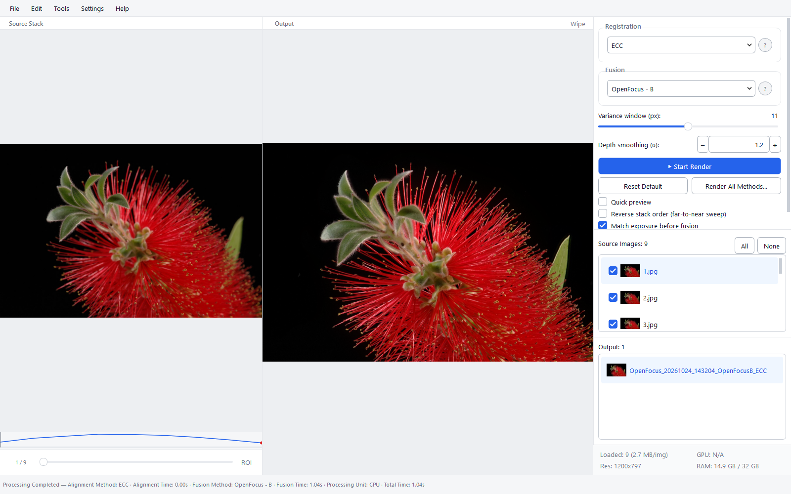

<p align="center">
  <a href="https://github.com/Xinzhe99/OpenFocus">
    
  </a>
</p>

<h1 align="center">OpenFocus</h1>

<p align="center"><strong>Elk scherptevlak. Eén volledig scherp beeld.</strong></p>

<p align="center">
  Acht fusiemethoden, drie registratiemodi en een bronvaste retoucheerwerkruimte voor macro, microscopie en industriële stapels. 16-bit van begin tot eind, een headless CLI en een interface in twaalf talen.
</p>

<p align="center">
  <a href="https://github.com/Xinzhe99/OpenFocus/releases"></a>
  <a href="https://github.com/Xinzhe99/OpenFocus/stargazers"></a>
  <a href="./LICENSE"></a>
  
</p>

<p align="center">
  
  
  
  <a href="https://pypi.org/project/openfocus/"></a>
</p>

<p align="center">
  <a href="#download">Download</a> ·
  <a href="./docs/USER_MANUAL_NL.md">Documentatie</a> ·
  <a href="#command-line-usage">CLI</a> ·
  <a href="./CHANGELOG.md">Wijzigingen</a> ·
  <a href="https://doi.org/10.5281/zenodo.23050823">DOI</a>
</p>

<p align="center">
  <a href="README.md">English</a> ·
  <a href="README.zh-CN.md">简体中文</a> ·
  <a href="README.ja.md">日本語</a> ·
  <a href="README.es.md">Español</a> ·
  <a href="README.de.md">Deutsch</a> ·
  <a href="README.fr.md">Français</a> ·
  <a href="README.ru.md">Русский</a> ·
  <a href="README.ko.md">한국어</a> ·
  <a href="README.pt.md">Português</a> ·
  <a href="README.it.md">Italiano</a> ·
  <strong>Nederlands</strong> ·
  <a href="README.pl.md">Polski</a>
</p>

<p align="center">
  
</p>

## 📢 News

> [!NOTE]
> **v1.68.1** — batchexport volgt de gekozen modus: alleen uitlijnen maakt één `<stack>_aligned`-map en toont die in de lijst, fusie toont alleen het gefuseerde beeld, en zonder uitlijning exporteren wordt alleen dat beeld geschreven. Achtergebleven `*_registered*`-kopieën in de bronmap worden niet meer als frames geladen. Ook labels, schaalbalken, methodevergelijking, diepte-/modelexport, updates en retouche zijn herzien volgens de audit in `docs/ux-specs`.

<a id="download"></a>
## Download en installatie

Download een build via [Releases](https://github.com/Xinzhe99/OpenFocus/releases):

| Platform | Bestand | Type |
|----------|---------|------|
| Windows 10/11 (64-bit) | `OpenFocus-*-setup.exe` | **Installer** (aanbevolen) |
| Windows 10/11 (64-bit) | `OpenFocus-*-windows-x64.zip` | Draagbaar (uitpakken en starten) |
| macOS Apple Silicon (M1–M4) | `OpenFocus-*-macos.dmg` | Schijfimage (naar Programma's slepen) |
| macOS Apple Silicon (M1–M4) | `OpenFocus-*-macos-arm64.zip` | Draagbaar (uitpakken) |

De app is niet ondertekend. Bij de eerste start kan Windows vragen om “Meer informatie → Toch uitvoeren”; op macOS: rechtermuisknop → Open of `xattr -cr /Applications/OpenFocus.app`.

## Functies

<table>

<tr>
<td width="46%" valign="middle">

### Acht fusiemethoden

Vier klassieke methoden plus de OpenFocus A/B/C-familie en het neurale StackMFF-V3-model, allemaal op dezelfde uitgelijnde stapel: vergelijk en kies per onderwerp in plaats van één standaardwaarde te vertrouwen.

[Algoritmen →](#algorithms)

</td>
<td width="54%">



</td>
</tr>

<tr>
<td width="46%" valign="middle">

### A/B-wipe

Sleep de scheiding tussen een bronframe en het resultaat om te zien wat de fusie veranderde: uitlijningsdrift, halo's langs randen en verloren detail, bij elke zoomstand.

[Handleiding →](./docs/USER_MANUAL_NL.md)

</td>
<td width="54%">


</td>
</tr>

<tr>
<td width="46%" valign="middle">

### Methodenvergelijking

Render alle methoden één keer, vergelijk ze naast elkaar op dezelfde uitsnede en neem de winnaar over als nieuwe uitvoer of kopieer de parameters terug naar het hoofdvenster.

</td>
<td width="54%">


</td>
</tr>

<tr>
<td width="46%" valign="middle">

### Dieptekaart en 3D

Focuspositie per pixel uit vijf focusmaten, wetenschappelijke kleurenschalen, fysieke Z-kalibratie uit TIFF-metadata en getextureerde OBJ-export van het oppervlak.

</td>
<td width="54%">


</td>
</tr>

<tr>
<td width="46%" valign="middle">

### Bronvaste retouche

Schilder vanuit de frames die het resultaat echt hebben gemaakt: gedeelde zoom en pan, bronframe-schuif, zachte penseel, herstelpenseel, undo per streek en bescherming van niet-geëxporteerde pixels.

</td>
<td width="54%">


</td>
</tr>

<tr>
<td width="46%" valign="middle">

### Batchverwerking

Wijs een map met stapels aan, kies methode en bestemming en laat het lopen. Alleen uitlijnen schrijft één map per stapel; fusie schrijft en toont alleen het gefuseerde beeld.

</td>
<td width="54%">


</td>
</tr>

<tr>
<td width="46%" valign="middle">

### Schaalbalken voor publicatie

Gekalibreerd uit TIFF-metadata of handmatig, getekend met het echte lettertype op de echte lengte en ingebrand in elke export: losse afbeelding, stapel, TIFF, GIF en batch.

</td>
<td width="54%">


</td>
</tr>

</table>

**Ook inbegrepen:**

- **Focus-stackingworkflow** — stapelbrowser, scherptecurve, snelle voorvertoning, ROI-render en per methode onthouden instellingen na herstart.
- **Klaar voor microscopie** — 16-bit van begin tot eind, µm/px uit TIFF, flat-fieldcorrectie, meerbladige TIFF-Z-stacks.
- **Headless CLI** — dezelfde pijplijn als `openfocus`, met batch, `--dry-run`, `--resume` en JSON-uitvoer.
- **Projecten en herstel** — `.ofproj`-sessies, automatisch herstel na een crash, undo/redo voor stapels en annotaties.
- **Twaalf UI-talen** — English, 简体中文, 日本語, Español, Deutsch, Français, Русский, 한국어, Português, Italiano, Nederlands, Polski; automatisch gedetecteerd, een nieuwe taal is één `locales_<code>.py`-bestand.
- **Zuining met geheugen** — de neurale gewichten laden alleen bij de AI-methode, dus een klassieke sessie blijft rond 110 MB in plaats van 260 MB.

## Snel starten

```bash
# Volledige CLI: alle methoden, AI-model, HEIC en camera-RAW
pip install openfocus

# Een map met afbeeldingen fuseren
openfocus -i ./stack_folder -o ./result/fused.png

# DTCWT met ECC en 8 threads
openfocus -i ./stack_folder -o ./result/fused.png -m dtcwt -a ecc -t 8
```

GUI vanuit de broncode starten:

```bash
conda create -n openfocus python=3.10
conda activate openfocus
pip install -r requirements.txt
python main.py
```

## Documentatie

- [Gebruikershandleiding (Nederlands)](./docs/USER_MANUAL_NL.md)
- [Wijzigingslog](./CHANGELOG.md)
- [Prestaties en grote stacks](./docs/PERFORMANCE.md)
- [Buildcommando's](./docs/BUILD_COMMANDS.md)
- [Algoritmepariteit](./docs/ALGORITHM_PARITY.md)

De volledige Engelse referentie staat in [README.md](./README.md).

## Citatie en licentie

Als OpenFocus je werk helpt, citeer het project via [CITATION.cff](./CITATION.cff).

Het project valt onder de [MIT-licentie](./LICENSE). Elk fusie-/uitlijningsalgoritme behoudt daarnaast zijn oorspronkelijke licentie.
