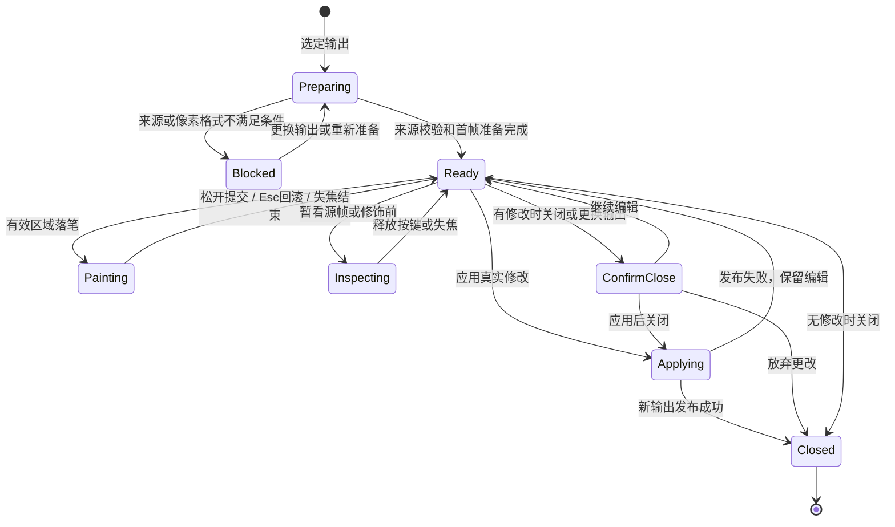

# 修饰结果功能重设计 Spec

**状态：已实现（v1.67.0）。** 本文保留为验收依据；文中的“后续实现”均已完成，性能数字仍是需要持续测量的目标。实现落点：`core/render_context.py`（渲染来源）、`controllers/output_manager.py`（稳定输出身份与导出保护）、`utils/retouch.py`（笔画事务/瓦片历史）、`dialogs/retouch.py`（同步工作区）。

本功能用于修复多焦点融合结果中的局部光晕、错选细节、断裂边缘等问题：用户查看同一次渲染使用的源帧，把选定帧在对应坐标处的像素涂入结果，或局部恢复修饰前的结果。目标是让用户始终清楚三件事：**正在修哪张结果、从哪一帧取材、这一笔实际改了哪里。**

文中“必须”是实现和验收要求；默认值是本设计的决定。性能数字是后续实现的验收目标，不代表当前版本已达到。

## 1. 现状、证据与问题边界

### 1.1 截图可以确认的问题

- 画布上方、下方存在大块未用于操作的空白；底部只有一条很长的选帧滑块，无法直接浏览各帧。
- 源图和结果的显示比例不同，同一细节不容易横向对照。
- “融合结果（在此修饰）”没有指出具体输出名称，多个算法、多个历史结果并存时容易产生歧义。
- 画笔只有滑块，缺少精确数值输入；没有清楚展示倍率、修饰状态和还原局部的入口。
- 提示文字提到了自动选帧，但界面中没有对应控件。

**[INFERENCE]** 截图中的花朵大小差异不能单独证明配准错误，也可能来自视图倍率。设计必须分别解决“显示不同步”和“像素来源不匹配”，不能用强行缩放图像掩盖二者。

### 1.2 代码和只读检查确认的问题（修复前）

| 编号 | 已确认的现状 | 影响 | 代码依据 |
|---|---|---|---|
| P01 | 入口按输出顺序遍历候选，没有以当前选中输出作为唯一修饰对象 | 用户选择的结果与实际打开的结果可能不同 | `main.py::OpenFocus.show_retouch_dialog` |
| P02 | 源栈匹配主要检查第一帧尺寸；还接受尺寸差小于 16 像素时的左上裁剪 | 无法证明来源、配准、裁剪原点相同；也未验证每一帧 | `utils/retouch.py::frames_matching` |
| P03 | 左右视图独立缩放、平移；切换源帧调用 `fitInView`；适应窗口只调整结果侧 | 放大观察后换帧会丢失检查位置，左右无法稳定对照 | `dialogs/retouch.py::_View`、`set_source_frame`、`_fit` |
| P04 | 每次画笔采样都读取当前滑块帧号及当前参数 | 同一笔中切换帧或参数，会破坏“一笔来自一个源”的语义 | `RetouchDialog._dab`、`stroke_begin` |
| P05 | 文案仍描述自动选帧，实际笔画只使用手动选中的帧；模块注释称有缩略图，实际只有滑块 | 用户无法根据说明预测操作结果 | `dialogs/retouch.py`、`locales.py` 的修饰文案 |
| P06 | 每帧清晰度图单独按自身最大值归一化；颜色说明与实际色图不一致 | 颜色不能可靠地用于跨帧清晰度比较 | `RetouchDialog.sharpness_overlay` |
| P07 | 是否可取得编辑结果依赖 `_edited` 和是否有撤销项；没有明确的未应用更改关闭流程 | 实际像素变化、历史记录和保存状态混在一起 | `RetouchDialog.edited_result`、应用/取消连接 |
| P08 | 落笔时分配整幅图大小的浮点覆盖数组；撤销主要限制笔画数量 | 小范围修饰也产生大额内存开销，长会话资源上限不清楚 | `RetouchDialog.stroke_begin`、`utils/retouch.py::TileUndo` |
| P09 | 历史输出主要保存像素数组；当前 `registration_results` 会被后续渲染替换；工程快照不保存修饰像素 | 历史结果缺少自己的来源依据，工程保存不能被当作修饰图像保存 | `controllers/output_manager.py`、`controllers/render_manager.py`、`utils/project_file.py` |

只读、独立进程检查得到以下结果，没有操作用户正在使用的窗口或写入工程：

- 源视图缩放值在换帧前为 `3.4667`，换帧后回到 `1.7333`，确认换帧重置倍率。
- 用常量值 60 和 220 的两帧，在一笔中切换源帧，得到同一笔起点像素 60、终点像素 220。
- 同尺寸但内容无关的源帧被 `frames_matching` 接受；第一帧为 `180×240`、第二帧为 `80×80` 的混合尺寸列表也被接受。
- 构造的窗口没有自动选帧控件，结果标题仍为通用的 “Fused result (retouch here)”。

以上用于约束设计，不构成对当前功能“已经修好”的声明。

## 2. 功能定位与设计决定

### 2.1 必须覆盖的工作

1. 从输出列表准确打开一张有可靠来源的融合结果。
2. 在相同坐标、倍率和显示变换下对照源帧与修饰结果。
3. 明确选帧，用软边画笔复制同坐标像素；用还原画笔恢复修饰前的局部。
4. 按笔画撤销、重做，查看修饰前后，安全取消或发布新输出。
5. 对 8 位、16 位结果保持尺寸、位深与色彩含义；支持具有明确映射的裁剪、缩放结果。
6. 在大图、多帧、高 DPI、不同窗口大小和十二种界面语言下保持可用。

### 2.2 本次设计的边界

- 定位为**源帧取材修饰**，不提供自由偏移的克隆图章、生成式修补、液化或通用图层系统。
- 默认且唯一的取材决策是用户手动选帧；不提供不可解释的自动换帧，也不保留相应说明或隐藏开关。
- 清晰度参考图可以辅助判断，但不自动选帧、不自动改像素，也不承诺消除所有融合缺陷。
- 不覆盖原始源图或原输出，不在修饰中偷偷重新配准、重新融合或改变图像尺寸。
- 本次定义会话内撤销/重做、应用新输出和导出边界；不新增独立修饰工程格式，不承诺跨重启恢复未应用笔画或撤销历史。现有 `.ofproj` 不含这些像素，界面和文档必须如实说明。
- 有明确来源的 ROI、缩放、DCT 边界裁剪结果纳入设计；缺少来源信息的旧输出应说明原因并引导重新渲染，不能按尺寸猜测后放行。

## 3. 用户流程与入口

### 3.1 选定修饰对象

| 入口/状态 | 行为 |
|---|---|
| 输出列表某项的右键“修饰结果” | 打开被右键指定的这一项；先同步可见选中状态 |
| 编辑菜单“修饰结果”或 `Ctrl+T` / macOS `Cmd+T`，恰有一项选中 | 打开该项，无论它是不是最新结果 |
| 有输出但没有选中项 | 展示结果选择器，列出名称、缩略图、尺寸、生成方法和可修饰状态；由用户选择 |
| 多项选中 | 提示只支持一次修饰一张；不擅自取第一项 |
| 没有输出 | 显示“请先生成融合结果”，不打开空编辑器 |
| 选中的输出没有有效来源 | 明确显示不可修饰的原因和“返回输出列表 / 重新渲染”路径；不换成另一张结果 |

编辑期间固定底图。若要更换结果，通过顶部“更换结果”发起；有更改时先走第 9 节的保存/放弃流程，不能用下拉框静默替换正在编辑的像素。

### 3.2 标准使用流程

1. 选中要修饰的输出，进入工作区；顶部显示该结果的名称和图像规格。
2. 校验来源，加载参考坐标中的源帧。加载期间可看结果，绘制暂不可用。
3. 在底部缩略图或帧滑动条中选一帧，左右同步放大到缺陷位置。
4. 在左侧确认这帧的细节，右侧使用“源帧画笔”修饰；光标在左侧给出对应位置。
5. 用“还原画笔”、撤销/重做及“查看修饰前”检查和纠正。
6. 点击“应用为新输出”。原图保留，主窗口选中新生成的修饰结果。
7. 需要长期保存时使用主窗口导出；界面明确区分“已应用到输出列表”和“已导出文件”。

## 4. 工作区布局

### 4.1 默认布局

画布是主要工作区域。标题、工具栏、工具面板、源帧条和底部操作区各有固定职责，剩余高度全部给画布，不用大块弹性空白隔开操作区。

```svg
<svg xmlns="http://www.w3.org/2000/svg" viewBox="0 0 1000 650">
  <g fill="none" stroke="var(--border)" stroke-width="1">
    <rect x="8" y="8" width="984" height="45" rx="5"/>
    <rect x="8" y="60" width="984" height="36" rx="5"/>
    <rect x="8" y="104" width="354" height="414" rx="4"/>
    <rect x="370" y="104" width="354" height="414" rx="4"/>
    <rect x="732" y="104" width="260" height="502" rx="4"/>
    <rect x="8" y="526" width="716" height="80" rx="4"/>
    <rect x="8" y="614" width="984" height="28" rx="4"/>
  </g>
  <g font-family="sans-serif" font-size="14" fill="var(--fg)">
    <text x="20" y="36">修饰结果 · 花卉_DCT · 16 位 · 未应用更改</text>
    <text x="646" y="36">更换结果</text><text x="764" y="36">全屏 F11</text>
    <text x="20" y="83">撤销　重做　│　适应 F　100%　│　并排 / 专注结果　│　查看修饰前</text>
    <text x="20" y="130">采样源 7 / 9 · 7.jpg</text>
    <text x="382" y="130">修饰结果 · 花卉_DCT</text>
    <text x="70" y="224" fill="var(--muted)">参考源帧</text>
    <text x="438" y="224" fill="var(--muted)">仅在此画布绘制</text>
    <text x="75" y="470" fill="var(--muted)">与右侧共享倍率和观察位置</text>
    <text x="438" y="470" fill="var(--muted)">画笔只影响圈内有效像素</text>
    <text x="748" y="135">工具</text>
    <text x="748" y="166" fill="var(--accent)">● 源帧画笔　○ 还原画笔</text>
    <text x="748" y="207">直径　64 px　　[ −　64　+ ]</text>
    <text x="748" y="253">硬度　40%　　 [ −　40　+ ]</text>
    <text x="748" y="299">不透明度　100%</text>
    <text x="748" y="349">□ 显示清晰度参考图</text>
    <text x="748" y="383" fill="var(--muted)">取材帧固定到本笔结束</text>
    <text x="748" y="423">还原全部…</text>
    <text x="748" y="553">应用为新输出</text>
    <text x="748" y="586">取消</text>
    <text x="20" y="549">源帧</text>
    <text x="20" y="633">100%　·　x: 420  y: 300　·　取材帧 7 / 9　·　未导出</text>
  </g>
  <g fill="none" stroke="var(--muted)" stroke-width="1">
    <path d="M100 395 Q125 270 185 247 Q218 295 279 336 L238 400 Z"/>
    <path d="M462 395 Q487 270 547 247 Q580 295 641 336 L600 400 Z"/>
    <circle cx="193" cy="312" r="28"/>
    <path d="M183 312 H203 M193 302 V322"/>
    <circle cx="555" cy="312" r="28" stroke="var(--accent)" stroke-width="2"/>
    <circle cx="555" cy="312" r="11" stroke="var(--accent)" stroke-dasharray="3 3"/>
    <path d="M748 223 H972 M748 269 H972 M748 315 H972"/>
    <rect x="77" y="538" width="56" height="56" rx="3"/>
    <rect x="146" y="538" width="56" height="56" rx="3"/>
    <rect x="215" y="538" width="56" height="56" rx="3"/>
    <rect x="284" y="538" width="56" height="56" rx="3"/>
    <rect x="353" y="538" width="56" height="56" rx="3"/>
    <rect x="422" y="538" width="56" height="56" rx="3"/>
    <rect x="491" y="538" width="56" height="56" rx="3" stroke="var(--accent)" stroke-width="2"/>
    <rect x="560" y="538" width="56" height="56" rx="3"/>
    <rect x="629" y="538" width="56" height="56" rx="3"/>
  </g>
  <g font-family="sans-serif" font-size="14" text-anchor="middle" fill="var(--fg)">
    <text x="105" y="571">1</text><text x="174" y="571">2</text><text x="243" y="571">3</text>
    <text x="312" y="571">4</text><text x="381" y="571">5</text><text x="450" y="571">6</text>
    <text x="519" y="571" fill="var(--accent)">7 已选</text><text x="588" y="571">8</text><text x="657" y="571">9</text>
  </g>
</svg>
```

图中缩略图编号表示位置，实际界面必须显示对应源帧缩略图。图形和按钮样式沿用应用主题，不新增一套独立皮肤。

### 4.2 各区职责

| 区域 | 必须展示/支持 | 约束 |
|---|---|---|
| 顶部上下文 | 输出名称、宽高、位深、未应用状态、更换结果、全屏 | 长名称省略并提供完整提示；不能只写“融合结果” |
| 工具栏 | 撤销/重做、适应窗口、100%、当前倍率、布局切换、查看修饰前 | 不将“应用”设为普通回车的默认动作 |
| 左画布 | 当前取材帧、帧号/总数、文件名、与右侧对应的光标 | 只读，左键不绘制、不触发隐式放大 |
| 右画布 | 当前修饰结果、画笔范围、可选修饰前显示 | 唯一允许写入像素的画布 |
| 工具面板 | 源帧画笔/还原画笔、直径/硬度/不透明度、清晰度参考、还原全部、应用/取消 | 各数值同时支持滑块和数字输入；标签与输入作为整体换行 |
| 源帧条 | 缩略图、明确选中态、上一帧/下一帧、可编辑帧号 `7 / 9`、同步的帧滑动条 | 按本次渲染的实际取材帧序列展示；水平滚动仅限此条 |
| 状态栏 | 倍率、图像坐标、当前工具/源帧、加载状态、错误或未导出状态 | 精简说明；帮助内容放到工具提示，不占据长期操作面积 |

### 4.3 空间、全屏与主题

- 初始窗口优先 `1280×820` 逻辑像素，限制在当前屏幕可用区域内；记住上次正常窗口几何和侧栏宽度。
- 支持系统最大化、标题栏双击最大化、`F11` 全屏及可见的退出全屏按钮。退出全屏恢复之前的正常/最大化状态。
- 在 `1280×820` 下，画布区高度至少占内容区的 65%；源帧条目标高度 88–112 逻辑像素。没有为“拉长布局”单独保留的顶部或底部空白。
- 默认左右画布等宽、等高；侧栏初始约 272 逻辑像素，可在 240–360 之间调整。两画布共同分享剩余空间。
- 可切换到“专注结果”：隐藏左侧画布，源帧条和取材状态仍在；暂看源帧用于检查。切换布局不改变数据、倍率或观察中心。
- 窗口宽度低于 1024 或可用高度低于 640 逻辑像素时，侧栏可折叠、内部可滚动；默认使用专注结果，不能让窗口被控件最小宽度撑出屏幕。应用/取消始终可达。
- 明暗主题、高 DPI、多显示器必须沿用应用的颜色、字号和缩放规则；十二种语言不截断关键动作、数值单位和结果身份。

## 5. 来源、坐标与画布同步

### 5.1 修饰资格：来源一致优先于尺寸一致

每张可修饰输出必须关联一次不可变的渲染上下文，包括实际参与的帧、顺序、排除状态、预处理、配准、裁剪和缩放信息。修饰器不得从当前主窗口的 `raw_images` / `registration_results` 中临时猜一组尺寸相近的图。

| 输出情况 | 设计要求 |
|---|---|
| 无配准的完整融合 | 使用该次渲染的源帧和身份映射；明确显示“本结果未配准”，不虚构已对齐状态 |
| 有配准的融合 | 使用此次渲染对应的已配准图或原变换记录；所有源帧映射到结果参考坐标 |
| ROI 裁剪输出 | 记录准确的裁剪原点和尺寸；结果坐标映射到该 ROI，不允许按左上角猜测 |
| ROI 粘回整图 | 使用整图参考坐标并记录 ROI 合成范围。当前上下文仅保留 ROI 裁片：只在实际保留且有效的源像素内取材，ROI 外不可取材；不得按整幅结果尺寸推测来源覆盖域。 |
| DCT 等造成边缘裁剪 | 记录实际裁剪映射，不使用“小于 16 像素就裁掉”的启发式规则 |
| 缩放后融合 | 使用当次缩放比例、尺寸和插值规则生成的取材图；不能把显示预览拉伸当作原图 |
| 修饰后的新输出 | 继承底图的渲染上下文，父输出身份明确；允许再次打开修饰 |
| 比较功能产生的正式输出 | 每张正式结果各自关联其来源上下文；不借用最后渲染的算法结果来源 |
| 临时预览、只配准的文件夹、无来源的外部/旧结果 | 不当作有来源的融合结果编辑；说明原因，保留查看/导出的既有能力 |

帧身份必须包含稳定的帧 ID；多页 TIFF 还包括容器路径和页号。显示文件名不充当唯一 ID。排除帧、逆序、追加不同文件夹、改名不能造成帧号与实际像素错配。

### 5.2 共同坐标

- 建立唯一的结果像素坐标域 `R=[0,W)×[0,H)`，左上为原点，x 向右、y 向下。
- 所有笔画、光标、源帧读区和撤销脏区均用该坐标域表达。显示矩形或鼠标屏幕位置只在输入/显示边界转换。
- 每个源帧具有到结果坐标域的映射和有效像素掩码。配准填充黑边不视为可取材的黑色内容。
- 两视图共享一个观察状态：图像坐标中心、倍率、适应模式；默认始终联动，不暴露容易造成误操作的独立倍率开关。
- 以 `s` 表示每个图像像素占据的逻辑像素数，`c` 表示观察中心，`o` 表示视口中心，则图像点 `p` 显示为 `o+s(p-c)`。反算使用同一组参数；高 DPI 换算只做一次。
- 倍率 100% 定义为一个图像像素对应一个屏幕物理像素；设备像素比为 `d` 时，逻辑比例 `s=1/d`。移动到不同 DPI 的屏幕不移动观察中心。
- “适应窗口”取能同时装入两侧视口的共同倍率。留白用于保持纵横比，不能分别放大到不同尺寸。
- 放大/平移后切换帧、切换清晰度图、调整侧栏或进入全屏，必须保留图像坐标中心和倍率。仅在仍处于适应模式时随视口重算共同倍率。
- 两画布的对应位置误差不得超过 0.5 个图像像素；画笔可见边界与实际修改范围一致，不能因缩放而改变量径。

## 6. 取材与画笔交互

### 6.1 选帧

- 在同一渲染上下文再次打开时沿用上次人工选择；首次打开选择第一个有效帧，明确显示编号，不声称它是最清晰帧。
- 点击缩略图、上一/下一帧、输入帧号或 `,` / `.` 可换帧。首末帧不循环跳转；对应方向按钮禁用。
- 每次换帧只改变取材预览，不改变结果、不创建历史项、不标记为已编辑。
- 逐帧加载时保留上一帧预览并覆盖“正在加载第 N 帧”，禁止落笔。只有新帧像素、标题和选中态一致时才能绘制。
- 刷新任务携带请求版本；快速切帧返回的旧结果不得覆盖新帧。
- 笔画进行中锁定取材帧和工具参数；换帧及调整参数的控件暂不可操作，快捷键不产生延迟切换。松开后才允许下一次选择。

### 6.2 两种工具

| 工具 | 采样内容 | 用途 |
|---|---|---|
| 源帧画笔 `B` | 当前锁定帧在对应结果坐标的有效像素 | 用确认清晰的细节替换融合缺陷 |
| 还原画笔 `E` | 本次会话开始时的底图像素 | 局部擦除本次修饰，不擦成透明、不从任意源帧补回 |

打开一个已经修饰过的输出时，“修饰前”指此次打开的底图，不是更早的祖先输出。

画笔直径默认 64 图像像素，范围 1–2048；硬度默认 40%，范围 0–100%；不透明度默认 100%，范围 1–100%。数值输入与滑块同步。直径为 1、硬度为 100% 时必须有明确的单像素/硬边语义，不能产生除零或隐藏羽化。

### 6.3 一笔的确定性

1. 在右侧图像的有效区域按下左键，才开始笔画；按在留白处不开始，拖入图像也不会突然开始绘制。
2. 起笔时锁定工具、帧 ID、直径、硬度、不透明度、图像坐标变换，并保存受影响区域的笔前像素。
3. 鼠标路径按图像坐标插值；建议采样间距不大于 `max(1, D/8)` 像素。快速拖动不能出现空洞，显示刷新可以合并，必要的路径和释放终点不能丢。
4. 同一笔覆盖过的像素使用该笔最大覆盖率，不因鼠标事件频率或慢速停留反复变深。
5. 松开提交一条撤销记录；下一笔允许继续叠加不透明度。没有真实像素变化的笔画不进入历史。

令 `C0` 为笔前像素、`S` 为本笔固定取材像素、`m_j` 为路径第 j 个采样的软边掩码、`o` 为不透明度，则：

`a(p) = o × max_j(m_j(p))`

`C(p) = (1 − a(p)) × C0(p) + a(p) × S(p)`

仅在源帧有效区域和图像边界内写入。硬度表示中心实心区域比例，之外平滑衰减；100% 为硬边圆形。覆盖与插值在足够精度下计算，量化到结果位深；同一笔重叠采样造成的误差最多一个目标位深的灰度级。

- 右侧显示外圈直径和内圈硬度范围；左侧显示同坐标的参考圈。移动到不可采样处显示禁用光标/遮罩。
- 离开图像边界后仅裁剪绘制范围；没有捕获到有效按下事件的移动不得修改像素。
- 笔画中 `Esc` 回滚当前未提交整笔；窗口失焦或鼠标捕获丢失时，结束在最后有效采样点并提交已产生的修改，返回后不得接着“悬空绘制”。
- 笔画中不切换工具、源帧、倍率或视图模式；撤销指令先结束当前笔再撤销它。打开关闭确认前先结束当前笔。

### 6.4 观察操作与快捷键

快捷键只有在画布/编辑工作区具有焦点时生效。输入框、下拉菜单及确认对话框编辑期间不能截获字符或把 Enter 当作应用。

| 操作 | 行为 |
|---|---|
| 右键/中键拖动，或空格 + 左键拖动 | 平移两画布；不画图。空格预览手形，松开恢复当前工具 |
| 滚轮、`+` / `−` | 围绕指针所指图像点联动缩放；范围 5%–1600% |
| `F` / 适应窗口 | 两侧重新采用共同适应倍率 |
| `1` / 100% | 原始像素检查，保持观察中心 |
| `[` / `]` | 减小/增大直径；不越界 |
| 按住 `Tab` / 按住“查看修饰前” | 右侧临时展示底图；松开恢复当前编辑；预览期间禁止落笔 |
| 按住 `Alt` / 按住“暂看源帧” | 右侧临时展示当前取材帧，方便专注结果模式观察；松开恢复，无写入 |
| `Ctrl+Z` / `Cmd+Z` | 撤销上一条已提交编辑 |
| `Ctrl+Y` 或 `Ctrl+Shift+Z` / `Cmd+Shift+Z` | 重做 |
| `F11` | 全屏切换；笔画中不切换 |
| `Esc` | 优先取消当前笔；否则退出临时查看；否则退出全屏；否则走关闭流程 |
| `Ctrl+Enter` / `Cmd+Enter` | 有实际修改且空闲时应用为新输出 |

Tab/Alt/空格均为临时查看或导航；释放、焦点切换及菜单抢焦点必须清理临时状态，不能卡在预览中。Tab 与 Alt 不叠加，先进入的预览模式优先。

## 7. 清晰度参考与图像准确性

### 7.1 清晰度参考图

- 默认为关，仅覆盖左侧源帧视图；开关不改变取材数组或右侧结果。
- 带“低细节 → 高细节”图例和解释：“局部细节参考，噪声和纹理也会影响；请查看原图确认。”不把颜色命名为“正确/错误”。
- 同一来源上下文使用共同的清晰度度量、尺度和归一化范围；不得每帧独立拉满而暗示可直接比较。
- 后台基于统一分辨率的预览计算，结果带帧 ID 和上下文版本。计算期间画笔仍可用；显示参考图不能阻塞手动取材。
- 提供明确的原图查看方式，关闭即恢复源帧原显示。不能将热力图像素涂入结果。

### 7.2 位深、颜色和标注

- 工作像素保留底图 `uint8` / `uint16` 与灰度/BGR 通道语义；显示使用统一的 `to_display_uint8()` 路径，显示缓冲不得回流为编辑数据。
- 取材应对应此次融合的对齐、平场/曝光等预处理状态；曝光增益与帧序记录在渲染上下文中，不能在当前 UI 重新估算。算法融合后对底图的全局校正不等于所有源帧也有同样校正，不能声称取材无色差。
- 混合在结果数据范围中进行，不按每个笔刷小块重新拉伸对比度。8 位源映射到 16 位满量程时使用固定映射，例如 `255 → 65535`，不降低底图位深。
- 不为掩盖来源错误添加自动局部调色。用户通过取材选择、软边和不透明度处理接缝，修饰前后检查必须诚实显示变化。
- 标签、比例尺、光标、清晰度图是显示/导出叠加层，不属于取材或编辑像素。工作区默认不显示标签和比例尺，已有标注配置保持；新输出导出时继续按现有标注规则处理，不能重复烧入。
- 不支持的像素格式或缺失的颜色转换依据，应在准备阶段明确报告；不能静默丢通道或降位深。

## 8. 撤销、状态与资源

### 8.1 状态转换



“有无更改”是独立属性，不等同于是否能撤销。状态表之外的异步结果必须检查会话 ID 和版本，不得改写已关闭或已更换的会话。

### 8.2 历史与脏状态

- 一次完整笔画为一条历史记录，包含模式、源帧 ID、参数和变化瓦片；不能把每个鼠标事件当作一步。
- 撤销和重做后像素必须逐值一致，包含 16 位精度；新编辑分支清空重做历史。
- 换帧、缩放、平移、预览和清晰度图开关不进入编辑历史。
- “还原全部…”在有修改时确认，恢复此次会话底图；它本身是可撤销的一步。
- 脏状态依据当前像素相对于底图的变化瓦片判定；撤销/还原到与底图相同时必须回到无修改。不能因为旧历史被淘汰就认为没有修改。
- “应用为新输出”仅在有真实修改、没有活动笔画、当前资源状态允许发布时可用。结果未变不生成重复输出。
- 历史默认最多 100 条且占用最多 512 MiB，以先达到的限制为准；额度计入撤销/重做缓存。淘汰旧记录时状态栏说明最早可撤销位置，不改动当前结果或底图。
- 活动笔画必须预留可回滚数据；若一笔大到无法在预算中安全保留，则整笔回滚，保留之前结果，提示“本笔覆盖范围过大，请分段修饰”。不能提交不可撤销的半笔。

### 8.3 内存与渲染约束

- 底图、源帧、渲染上下文只读共享；不为每次打开复制整组源帧。允许一份可写结果缓冲。
- 笔画覆盖和历史按变化瓦片分配；不能为每一笔分配整幅图大小的浮点掩码。
- 单次画笔刷新只转换/上传脏区；缩略图按需缓存，切帧不得重新生成所有全分辨率预览。
- 已打开会话持有底图和来源的生命周期引用；历史输出淘汰、主窗口的新渲染不能使这些像素悬空或换成别的栈。
- 处理大图之前估算所需缓冲与可用内存，准备失败时保留主窗口结果，提供具体原因。不能以图像降采样或假结果悄悄通过。

## 9. 应用、取消与保存边界

### 9.1 应用事务

“应用为新输出”必须满足以下原子性：

1. 固定当前编辑版本，结束活动笔画，阻止重复点击。
2. 完成结果所有权转移/必要复制及输出记录创建后，再发布到输出列表；过程中旧结果和源图保持可用且不变。
3. 新输出使用独立 ID，保留父输出 ID、来源上下文、尺寸和位深。名称为“原名称 · 修饰 1”，重名递增；命名不承载身份。
4. 只新增一项、更新输出计数、选中新项、刷新显示后关闭编辑器。操作不重新融合，也不让标注永久混入裸像素。
5. 失败时不留下半条输出，不关闭编辑器，不丢失笔画；错误可在原会话中处理后重试。

重新打开新输出可以继续修饰，旧的逐笔历史不跨窗口继承；新会话的还原基准就是新输出自身。

### 9.2 关闭与更换底图

- 没有像素修改：直接关闭，不弹确认。
- 有像素修改：统一使用“应用为新输出 / 放弃更改 / 继续编辑”三选项，默认“继续编辑”。标题栏关闭、取消按钮、窗口态 Esc、更换结果均遵循此规则。
- 选择放弃只销毁本会话缓冲；不删除底图、不覆盖原结果、不重写源图。
- 选择应用但发布失败时仍停留编辑器，不执行后续关闭或换图。

### 9.3 长期保存

- 应用的含义是加入本次会话输出列表，**不是自动保存图片文件**；状态栏应提示“已创建修饰输出，尚未导出”。
- 继续使用现有导出能力和 `imwrite_auto`。16 位结果默认建议保留位深的 PNG/TIFF；显式选择 JPEG 等降位深格式时遵循已有格式提示，不能静默改变工作像素。
- 未导出的修饰输出被删除、因历史数量上限将被淘汰或主应用退出时，必须提供导出/放弃/取消的决策，不能自动丢弃。历史已满时可以先完成导出或由用户明确选择可淘汰项；不无限扩张内存。
- 保存 `.ofproj` 或写现有恢复快照不清除“修饰像素未导出”状态，因为当前项目格式没有存这些像素。
- 未应用草稿和会话内撤销栈不承诺崩溃恢复；用户关闭行为仍受上面的未保存保护约束。若未来扩展工程格式，应单独设计像素持久化，不在这里伪装已经支持。

## 10. 数据契约与实现边界

以下是未来实现的概念契约，不是本轮新增的代码或 API。

### 10.1 必要数据

| 概念 | 必要字段/信息 | 不变量 |
|---|---|---|
| 输出记录 | 稳定输出 ID、类型、名称、像素引用、尺寸/位深、父输出 ID、来源上下文 ID、导出状态 | UI 当前行号或名称变化不会改变身份 |
| 渲染上下文 | 渲染 ID、源栈版本、参与帧 ID/路径/页号/校验依据与顺序、预处理与曝光参数、配准变换/已处理帧、缩放、裁剪、有效掩码 | 在输出存活期间不被主窗口当前配置替换 |
| 取材提供者 | 按帧 ID 请求结果坐标中的预览/像素区域/有效掩码；加载状态与错误 | 预览和笔画来自同一帧、同一坐标映射及数据处理版本 |
| 修饰会话 | 会话 ID、底图引用、工作缓冲、取材上下文、当前帧、画笔设置、活动笔、历史、变化瓦片、观察状态 | 与外部渲染隔离；单笔只读自己的固定快照 |
| 笔画记录 | 工具、固定源帧 ID、参数、变化区域、笔前/笔后数据或等价精确表示 | 可精确回滚；不依赖鼠标事件时间重新计算 |

源栈变化检测不能仅依赖文件名、数组尺寸或主窗口是否标记“已对齐”。可使用既有缓存的强校验依据，但必须覆盖实际帧内容、页号、顺序及几何预处理版本。

### 10.2 与现有代码衔接

| 位置 | 后续实现职责 |
|---|---|
| `controllers/render_manager.py`、`core/workers.py`、`core/multi_focus_fusion.py` | 在生成输出时保留真实来源和坐标信息，包含帧序、曝光预处理及裁剪；不是编辑器打开时再猜 |
| `controllers/output_manager.py`、`controllers/export_manager.py` | 按稳定身份选择/发布/导出结果，保持列表与记录一致，维护未导出保护与来源引用 |
| `main.py::show_retouch_dialog` | 校验入口选择、建立会话、接收发布结果；不内置画笔算法，不遍历历史偷偷换底图 |
| `dialogs/retouch.py` | 工作区组合、状态提示、快捷键作用域、关闭决策、异步预览版本管理 |
| `widgets/` 中的修饰视图 | 同坐标显示、笔刷光标、导航、脏区更新；复用现有图像显示及布局模式，避免第二套重复转换工具 |
| `utils/retouch.py` | 固定来源笔画、覆盖合成、还原工具、瓦片历史及边界处理；不依赖 UI |
| `utils/image_utils.py`、标注/比例尺既有通路 | 位深、显示转换、无损导出与叠加规则 |
| `locales.py`、`locales_extra.py`、八个语言包 | 十二种语言同步；清除不存在的自动选帧、缩略图或放大镜操作描述 |
| 现有项目/恢复流程 | 如实表达当前保存能力，不把保存设置或恢复快照误当作修饰像素已持久化 |

新实现要迁移所有产生和消费输出记录的入口，包括普通融合、比较正式输出、批处理、ROI、对齐文件夹和修饰结果；为不支持修饰的输出标明类型/原因。不得保留“新入口用来源 ID，旧入口仍按尺寸猜”的两套并行路径。

旧的 `frames_matching` 猜测式资格判定已从修饰通路移除；现在的尺寸检查只作为渲染上下文构建后的断言，来源鉴别由输出记录承担。

## 11. 错误与边界行为

| 情形 | 用户可见行为 | 数据要求 |
|---|---|---|
| 来源缺失、源文件被替换、旧结果无记录 | “无法确认该结果的取材来源，请重新渲染”及返回动作 | 不进入可绘制状态，不自动用当前栈替代 |
| 某帧加载失败 | 该帧标记失败，可选择其他有效帧或重试 | 已有编辑保留；失败帧不能显示成上一帧却使用新编号 |
| 所选位置超出某源帧有效范围 | 遮罩/禁用光标，提示该帧无有效像素 | 不复制配准填充边缘，不写黑块 |
| 快速换帧与清晰度计算竞争 | 显示最新请求状态 | 旧任务结果丢弃，永远不切换取材数组到过期帧 |
| 准备阶段内存不足 | 说明无法准备编辑缓冲，保留原输出 | 不创建空白编辑结果 |
| 一笔超出历史资源预算 | 整笔回滚，提示分段操作 | 之前已提交编辑完整保留 |
| 应用新输出失败 | 在编辑器中显示原因并允许重试 | 旧输出不动，当前工作缓冲不释放 |
| 导出失败或用户取消导出 | 保留“未导出”状态 | 不允许自动淘汰受保护输出 |
| 跨屏幕、缩放或窗口大小变化 | 保留观察中心，更新显示比例 | 不改变取材坐标和结果尺寸 |
| 未开始绘制、画在无效区域、源与目标相同 | 无修改，不开启应用、不新增历史 | 不制造空输出或假脏状态 |

## 12. 验收标准

### 12.1 功能验收矩阵

验收必须通过真实工作区操作检查对应像素/结果身份。核心数值测试可以辅助，不能仅靠按钮存在、函数被调用或测试替身计数证明用户行为正确。

| ID | 场景 | 必须得到的结果 |
|---|---|---|
| A01 | 输出 A/B 都存在，选中较旧 A 后从菜单/右键进入 | 顶部名称、底图像素和来源都属于 A；B 不被替代 |
| A02 | 无选中、多选、空输出、无来源输出分别进入 | 严格执行第 3 节规则，不暗选第一项 |
| A03 | 两个无关源栈尺寸相同；后一次渲染替换主窗口配准数组 | 老结果仍使用自己的来源，或明确阻止；不能混用 |
| A04 | 排除帧、逆序、跨文件夹同名图、多页 TIFF | 帧条编号、文件身份、实际涂入像素一一对应 |
| A05 | ROI 原点非零、DCT 裁剪、缩放结果 | 已知标记像素准确对位；没有来源映射则阻止 |
| A06 | 放大到 400%，平移后反复换帧/开关清晰度图 | 倍率和中心不变；左右对应位置误差 ≤0.5 图像像素 |
| A07 | 在不同 DPI、最大化、全屏、正常窗口间切换 | 图像坐标和笔刷直径一致；F11/Esc 恢复正确窗口状态 |
| A08 | 左侧点击、空白区域按下后拖入图像、平移和滚轮 | 没有任何像素修改 |
| A09 | 右侧点按、快拖、慢拖、越过边界再返回 | 连续有效轨迹、释放终点正确；边界外不写入 |
| A10 | 一笔未结束时尝试换帧、调参数或换工具 | 本笔来源和参数不变；没有混帧笔画 |
| A11 | 同一路径不同事件密度，50% 不透明度 | 同一笔结果差异 ≤1 个目标位深灰度级；另起一笔可继续叠加 |
| A12 | 直径 1、最大直径、硬度 0/100%、最低/最高不透明度 | 边界有明确定义，无异常，笔刷范围与像素结果一致 |
| A13 | 源帧画笔后使用还原画笔，再撤销/重做 | 局部恢复到本次底图；所有历史切换逐像素一致 |
| A14 | 修改后撤销到原状、画同色、还原全部，再撤销还原 | 脏状态和应用按钮对应实际像素；还原全部可撤销 |
| A15 | 达到历史额度后继续修饰、尝试过大笔画 | 淘汰提示正确；不能误清脏状态；过大笔画完整回滚 |
| A16 | Tab/Alt 临时查看、失焦、菜单抢焦点 | 松开/失焦恢复正确视图；预览期间不写像素 |
| A17 | 画笔中 Esc、普通 Esc、全屏 Esc、关闭有更改窗口 | 分别回滚当前笔、进入关闭流程、先退全屏、正确询问更改处置 |
| A18 | 应用后查看原图/新图、连续双击应用 | 仅一个新输出；原图不变，父子来源正确，列表计数正确 |
| A19 | 取消/放弃、发布失败后重试 | 不污染旧结果、不丢已有编辑、不遗留半条输出 |
| A20 | 16 位含细微阶梯的结果修饰、撤销、保存 PNG/TIFF 并重读 | 位深保持，未修改区域逐值不变；撤销逐值恢复 |
| A21 | 标签、比例尺和清晰度覆盖开启/关闭后修饰导出 | 辅助层不进入采样，标注不重复烧入，可按既有规则移除 |
| A22 | 快速选 1→5→2 帧并模拟加载乱序 | 最终编号、预览和落笔源均为 2，无短暂错误来源可绘制窗口 |
| A23 | 当前栈改变/新渲染完成/输出历史淘汰 | 活动修饰会话来源不变；未导出修饰输出不会被静默丢弃 |
| A24 | 保存工程但未导出修饰图，随后退出主应用 | 仍按未导出结果保护；不承诺工程保存了这些像素 |
| A25 | 中文/英文/长文本语言、明暗主题、1024×640 与 1280×820 | 操作可达、文字不互相挤压；画布占主要空间，无截图中的大块布局空白 |
| A26 | 再打开已修饰输出继续修饰 | 继承正确来源，以此次输出为还原基准，原父结果不变 |
| A27 | 清晰度参考图跨帧比较、噪声图和纯色图 | 统一尺度、图例准确，无除零；界面不把噪声高响应自动当作最佳取材 |

### 12.2 性能目标与测量方式

参考条件：Windows，CPU 模式，32 GB 内存；记录具体 CPU、Qt 版本、屏幕分辨率/DPI、源帧数及缓存状态。冷加载和热缓存结果分别记录，不能混成一个平均值。

| 项目 | 验收目标 | 测量边界 |
|---|---|---|
| 普通画笔反馈 | 直径 ≤256 px、24 MP 16 位结果，事件至脏区显示 P95 ≤33 ms | 连续拖动 10 秒，记录可见反馈延迟 |
| 源帧切换 | 已缓存预览 P95 ≤100 ms | 从用户选帧到正确预览和可绘制状态一致 |
| 冷源帧准备 | 100 ms 内出现明确加载反馈，可取消/换帧 | 总加载时间由文件/缓存决定，不伪报固定时限 |
| 导航响应 | 24 MP 数据的预览平移/缩放目标 ≥30 fps | 编辑缓冲始终原位深；只允许降低显示采样成本 |
| 撤销/重做 | 普通笔画触及 ≤1 MP 时 P95 ≤100 ms | 包含像素恢复和可见区域重绘 |
| 会话稳定性 | 连续换帧、绘制、撤销、重做 30 分钟不持续无界增长 | 分开统计工作缓冲、历史、源缓存和预览缓存 |

至少覆盖截图对应的小型九帧栈、24 MP 16 位栈及多帧压力样例。超出普通画笔范围的操作可以更慢，但必须保持可取消和数据一致，不能悄悄省略绘制。

## 13. 实施顺序与完成定义

以下顺序是已执行的实现顺序；完成定义仍然是交付门槛。

1. **先固定来源与输出身份**：补齐渲染上下文，迁移所有输出入口和选择逻辑；阻断按尺寸猜来源。
2. **再固定笔画和历史语义**：单笔来源锁定、还原工具、真实脏状态、位深、有效区域、资源边界。
3. **构建工作区**：同步画布、源帧缩略条、数字控件、导航、临时查看、全屏及响应式布局。
4. **接入发布与未保存保护**：原子新输出、导出状态、退出/淘汰保护及错误回退。
5. **完成验收与文案切换**：执行 A01–A27、真实窗口检查和性能测量，更新十二种语言及用户说明，删除旧的误导文案和猜测式修饰入口。

完成的定义是上述完整用户流程与所有验收项可复现通过，不是窗口能打开、单个画笔函数通过测试或新布局能截图。不得用“先做一个 UI、来源关系以后补”作为可发布的修饰功能。
