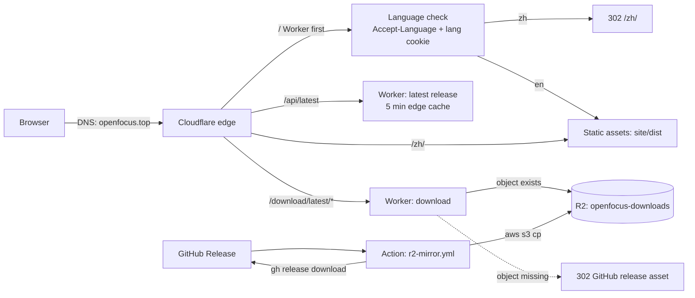

# OpenFocus website and download pipeline

Status: live at **https://openfocus.top** (English) and
**https://openfocus.top/zh/** (Simplified Chinese). Hosted as Cloudflare
Workers static assets; installers are mirrored to Cloudflare R2 and kept in
sync with the latest GitHub release.

This document is the operating manual for the public site. It is written so a
fresh agent (or maintainer) can change copy, deploy, mirror a release, or
debug DNS without reading the original session.

---

## 1. What exists

| Piece | Where |
|---|---|
| Site source (copy, template, CSS, JS) | `site/` |
| Worker (routing, language, latest release, R2) | `site/worker.js` |
| Cloudflare config | `site/wrangler.jsonc` |
| Installer scripts | `site/install.sh`, `site/install.ps1` |
| Build script | `tools/build_site.py` |
| Release → R2 workflow | `.github/workflows/r2-mirror.yml` |
| Build/deploy notes | `site/README.md` (short), this file (full) |

Cloudflare resources:

- Worker: `openfocus-site`
- Custom domains: `openfocus.top`, `www.openfocus.top`
- R2 bucket: `openfocus-downloads`, Worker binding `DOWNLOADS`
- Zone: `openfocus.top`, delegated to Cloudflare's nameservers
- Universal SSL: automatic, covers apex and `www`
- `workers.dev` route: disabled; the custom domain is the public URL

GitHub Actions secrets (names only, values never in the repo):

- `R2_ACCOUNT_ID`
- `R2_ACCESS_KEY_ID`
- `R2_SECRET_ACCESS_KEY`

The R2 token should be scoped to **Object Read & Write** on
`openfocus-downloads` only. Rotate it by creating a new R2 API token, updating
the three GitHub secrets, and deleting the old token.

Nothing in this repository contains account IDs, tokens, billing details, or
personal information.

---

## 2. Architecture



Only `/`, `/api/latest` and `/download/latest/*` invoke the Worker
(`run_worker_first` in `site/wrangler.jsonc`). Every other request is a static
asset and does not consume Worker requests.

- `/` — prefers Chinese from `Accept-Language` (or the `lang` cookie) and
  redirects to `/zh/`; English otherwise. Response: `Vary: Accept-Language,
  Cookie`, `Cache-Control: no-store`.
- `/zh/` — pre-rendered Chinese page.
- `/api/latest` — GitHub `releases/latest` reduced to
  `{tag, published, assets: {windows-setup, windows-zip, macos-dmg,
  macos-zip}}`, cached at the edge for 5 minutes.
- `/download/latest/<kind>` — resolves the latest asset, streams it from R2
  with `Range`/`206` support, and falls back to a `302` GitHub asset URL when
  the R2 object is missing.
- `www.openfocus.top` — `301` to `https://openfocus.top/` preserving path.
- Everything else — `site/dist` with `html_handling: auto-trailing-slash`,
  `not_found_handling: 404-page`, and the headers in `dist/_headers`.

### Page behavior

- Theme defaults to **light** on a first visit; the header toggle cycles
  light → dark → system and stores the choice in `localStorage`.
- The primary download button picks the visitor's OS (Windows/macOS/Linux).
- The language menu writes a `lang` cookie before navigating, so a manual
  choice beats `Accept-Language`.
- After load the page fetches `/api/latest` and updates the version label,
  file sizes and card links to `/download/latest/<kind>`. If that request
  fails, the static fallback links in `site_content.py` remain usable.
- No third-party scripts, fonts or analytics.

---

## 3. Build, preview, deploy

```bash
# Build into site/dist (git-ignored)
python tools/build_site.py

# With the production origin (canonical, sitemap, OG, installer commands)
SITE_ORIGIN=https://openfocus.top python tools/build_site.py

# Local preview (static only: no Worker language redirect or /api)
python -m http.server 8788 --directory site/dist

# Deploy Worker + assets (from the repo root)
npx wrangler deploy -c site/wrangler.jsonc
```

`SITE_ORIGIN` defaults to a placeholder `workers.dev` URL. **Always set it to
`https://openfocus.top` for production builds** so canonical, `hreflang`,
`sitemap.xml`, Open Graph URLs and the printed installer commands are correct.

`wrangler` requires an authenticated Cloudflare account (`npx wrangler login`)
with access to the `openfocus-site` Worker and the zone. Do not commit
wrangler credentials.

The build script:

- inlines `site/style.css` and `site/app.js` into each page;
- renders `site/template.html` with `site/site_content.py`;
- copies and optimises images from `assets/` (WebP, icons, OG image);
- copies `site/install.sh` and `site/install.ps1` to `dist/`;
- writes `robots.txt`, `sitemap.xml`, `_headers`, `404.html`.

---

## 4. Editing content

All copy lives in `site/site_content.py` under `LOCALES` (`en`, `zh`). The
template resolves `{{dotted.key}}` placeholders; missing keys fail the build.

- English is served at `/`; Chinese at `/zh/`.
- Adding a language: add one dict with the same keys and rebuild. The language
  menu, `hreflang` links and sitemap are generated from `LOCALES`.
- Counts in the copy (ten fusion methods, five alignment modes) must match the
  registries in `core/algorithms.py`; check before changing them.
- Media is copied from `assets/` (app screenshot, README posters, benchmark
  chart) — do not duplicate binaries under `site/`.
- `RELEASE` in `site_content.py` is the **no-JavaScript fallback**. The live
  page and installers read the latest release at runtime, but the static links,
  JSON-LD version and sizes should still be bumped when a release is cut.
- The English and Chinese slogans are intentionally different: the English
  line is "Every pixel, its sharpest frame."; the Chinese line is
  "每一像素，皆取自最清晰的一帧。"

---

## 5. Installer scripts

Both scripts resolve the latest release from `https://openfocus.top/api/latest`
and download through `https://openfocus.top/download/latest/<kind>` so China
downloads use the R2 mirror instead of GitHub.

`install.sh`:

- macOS Apple Silicon: downloads `macos-zip`, finds `OpenFocus.app`, installs
  it to `~/Applications`, clears quarantine, opens it.
- Linux: installs the CLI with `pipx` (or `python3 -m pip --user`). There is no
  Linux GUI build.
- Windows/MSYS: prints the PowerShell command.
- `--dry-run` prints the plan without downloading.

`install.ps1`:

- downloads `windows-setup` through the site and runs the installer;
- `OPENFOCUS_DRY_RUN=1` prints the plan without downloading.

Public commands:

```bash
curl -fsSL https://openfocus.top/install.sh | sh
```

```powershell
irm https://openfocus.top/install.ps1 | iex
```

If the asset naming in the release workflow changes, update the regexes in
`site/worker.js` (`-setup.exe`, `-windows-x64.zip`, `-macos.dmg`,
`-macos-arm64.zip`) and the kinds in `site_content.py`.

---

## 6. Release and mirror workflow

`.github/workflows/r2-mirror.yml` runs on:

- `release: published` — automatic for every new release on the default
  branch;
- `workflow_dispatch` with a `tag` input — manual backfill.

Steps:

1. `gh release download <tag>` for the four installer patterns.
2. `aws s3 cp assets/ s3://openfocus-downloads/ --recursive` against the R2
   S3 endpoint (`https://<R2_ACCOUNT_ID>.r2.cloudflarestorage.com`).
3. Delete objects whose key does not contain the current tag, so storage stays
   inside the R2 free tier.

Why R2: egress is free at any volume; the free tier is 10 GB-month storage, 1M
Class A operations and 10M Class B operations per month. A release is about
1.36 GB and four uploads; one mirrored release fits comfortably. Older
releases are pruned because the site only ever serves the latest.

The workflow must exist on the **default branch** (`main`) for release events
to fire. `workflow_dispatch` also requires it on `main` in this repository.

Manual backfill:

```bash
gh workflow run r2-mirror.yml -R Xinzhe99/OpenFocus --ref main -f tag=v1.74.0
gh run list -R Xinzhe99/OpenFocus --workflow r2-mirror.yml --limit 3
```

If the action fails, downloads still work: `/download/latest/*` falls back to a
`302` to the GitHub asset. Fix the action, then re-run it; no website redeploy
is needed.

### Release checklist

1. `constants.APP_VERSION` equals the release tag.
2. Publish the GitHub release with the four installer assets.
3. Wait for `r2-mirror` to succeed.
4. Verify:
   - `https://openfocus.top/api/latest` returns the new tag;
   - `curl -r 0-0 -I https://openfocus.top/download/latest/windows-setup`
     returns `206` and the new `Content-Range` length;
   - `https://openfocus.top/` shows the new version within 5 minutes.
5. Bump `RELEASE` in `site/site_content.py` and redeploy the site (optional,
   but keeps the no-JS fallback and JSON-LD current).

---

## 7. DNS, TLS, and domains

- The domain is registered at an external registrar. Its nameservers are
  delegated to Cloudflare, so Cloudflare is authoritative DNS.
- The zone is on the Cloudflare Free plan. Adding a custom domain to the
  Worker creates the proxied `Worker` DNS records for the apex and `www`
  automatically; do not add manual A/CNAME records.
- Universal SSL is automatic for the apex and first-level subdomains. During
  provisioning, public DNS may briefly return `100::` placeholder `AAAA`
  records; wait for certificate issuance.
- `www` is a custom domain and the Worker redirects it to the apex with `301`.
- **Domain expiry: 2027-11-02.** Auto-renew is intentionally off; renew
  manually before expiry. Registrar billing and account details are not part
  of this repository.

If the domain or zone moves, update:

- the custom domain bindings in `site/wrangler.jsonc`;
- `SITE_ORIGIN` for production builds;
- the `www` hostname check in `site/worker.js`;
- the hard-coded `https://openfocus.top` endpoints in `install.sh` /
  `install.ps1` (or derive them from a build-time value).

---

## 8. Mainland China access

- The site uses a custom domain on Cloudflare's global network. From mainland
  China it usually resolves to Hong Kong/Singapore and is reachable without a
  VPN, but there is **no SLA**.
- `*.workers.dev` and `*.pages.dev` are not usable in mainland China (DNS
  poisoning / SNI filtering). Do not switch the public URL back to
  `workers.dev`.
- Guaranteed mainland performance needs mainland hosting with ICP filing, or a
  mainland CDN; that is a separate deployment.
- Optional next step for very high download volume: connect a dedicated R2
  custom domain such as `dl.openfocus.top` and point download links there.
  Downloads then bypass the Worker request limit (100k/day on the free plan)
  and only count as R2 Class B operations.

---

## 9. Troubleshooting

| Symptom | Cause / action |
|---|---|
| Domain returns `100::` or NXDOMAIN right after setup | Nameserver delegation or custom-domain certificate still provisioning. Wait, flush local resolver cache, check `nslookup -type=A openfocus.top 1.1.1.1`. |
| `/` never redirects to `/zh/` | Worker not running (check `run_worker_first`), or a `lang=en` cookie is set. |
| Page shows old version / old file size | `/api/latest` edge cache is 5 minutes; wait or redeploy. |
| Download returns `302` to GitHub | R2 object missing (mirror action failed or has not run); fallback is expected. |
| Download returns `404` | The latest release does not contain that asset kind; check the release asset names. |
| Download stalls or resumes oddly | Range responses are `206` with `Content-Range`; 200 responses are cached for one day, 206 responses are `no-store`. |
| Installer cannot reach the site | The script uses `https://openfocus.top`; confirm the domain is live from that network. |
| Theme is dark on first visit | A stored `theme` preference wins; clear site data or use the toggle. Light is the first-visit default. |

Useful checks:

```bash
curl -I https://openfocus.top/
curl -I -H 'Accept-Language: zh-CN' https://openfocus.top/
curl -s https://openfocus.top/api/latest
curl -r 0-0 -D - -o NUL https://openfocus.top/download/latest/windows-setup
curl -I https://www.openfocus.top/
```

---

## 10. Cost and limits

- Cloudflare Workers Free: static asset requests are free and unlimited;
  Worker invocations are 100k/day. Only `/`, `/api/latest` and
  `/download/latest/*` invoke the Worker.
- R2: egress free; 10 GB-month storage, 1M Class A, 10M Class B per month.
  Overage: $0.015/GB-month, $4.50/M Class A, $0.36/M Class B.
- The website itself has no paid services beyond the domain registration.

OSS (Alibaba Cloud) and COS (Tencent Cloud) are alternative object stores, but
they charge for egress/CDN traffic and a mainland CDN requires ICP filing.
R2 is the current choice because egress is free and it sits in the same
Cloudflare account as the Worker.

---

## 11. Change log (this work)

- Added the bilingual static site (`site/`) with a hand-written template,
  light/dark/system themes, OS-aware download button, copy buttons, language
  menu, 404, sitemap, robots, Open Graph and JSON-LD.
- Added `tools/build_site.py` (inlined CSS/JS, image optimisation, page and
  metadata generation).
- Added the Cloudflare Worker: `/` language negotiation, `/api/latest`,
  `/download/latest/*` with R2 streaming/range and GitHub fallback, `www`
  redirect.
- Added `install.sh` and `install.ps1`, served from the site.
- Added the R2 download mirror (`openfocus-downloads`) and the
  `r2-mirror.yml` GitHub Action with old-release cleanup.
- Bound `openfocus.top` and `www.openfocus.top` as Worker custom domains.
- Added the build/deploy notes in `site/README.md` and this document.

---

## 12. Deliberately excluded

To keep the repository and this document safe to publish, the following are
**not** recorded here and must not be committed:

- Cloudflare account IDs, zone IDs, API tokens, R2 access keys or secret keys;
- registrar account details, order numbers, billing information or payment
  methods;
- personal names, addresses, phone numbers or email addresses used for domain
  registration or billing;
- any per-session credentials printed by `wrangler`, Stripe or the registrar.

Secrets live only in GitHub Actions secrets and the Cloudflare dashboard.
