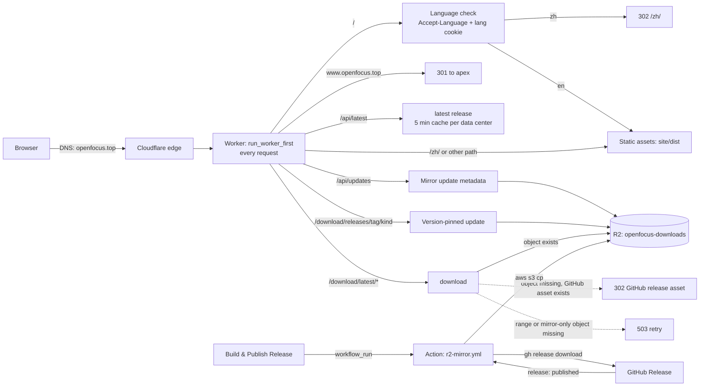

# OpenFocus website and download pipeline

Status: live at **https://openfocus.top** (English) and
**https://openfocus.top/zh/** (Simplified Chinese). Hosted as Cloudflare
Workers static assets; installers are mirrored to Cloudflare R2 and kept in
sync with the latest GitHub release.

This document is the operating manual for the public site. It is written so a
fresh agent (or maintainer) can change copy, deploy, mirror a release, or
debug DNS without reading the original session.

---

## 1. What exists

| Piece | Where |
|---|---|
| Site source (copy, template, CSS, JS) | `site/` |
| Worker (routing, language, latest release, R2) | `site/worker.js` |
| Cloudflare config | `site/wrangler.jsonc` |
| Installer scripts | `site/install.sh`, `site/install.ps1` |
| Build script | `tools/build_site.py` |
| Release → R2 workflow | `.github/workflows/r2-mirror.yml` |
| Build/deploy notes | `site/README.md` (short), this file (full) |

Cloudflare resources:

- Worker: `openfocus-site`
- Custom domains: `openfocus.top`, `www.openfocus.top`
- R2 bucket: `openfocus-downloads`, Worker binding `DOWNLOADS`
- Zone: `openfocus.top`, delegated to Cloudflare's nameservers
- Universal SSL: automatic, covers apex and `www`
- `workers.dev` route: disabled; the custom domain is the public URL

GitHub Actions secrets (names only, values never in the repo):

- `R2_ACCOUNT_ID`
- `R2_ACCESS_KEY_ID`
- `R2_SECRET_ACCESS_KEY`

The R2 token should be scoped to **Object Read & Write** on
`openfocus-downloads` only. Rotate it by creating a new R2 API token, updating
the three GitHub secrets, and deleting the old token.

Nothing in this repository contains account IDs, tokens, billing details, or
personal information.

---

## 2. Architecture



With `run_worker_first: true` in `site/wrangler.jsonc`, every request reaches
the Worker. It handles `/`, the website and desktop update APIs and download
routes, and `www` canonicalisation; other requests go to the static binding.
Every page and asset request therefore counts as a Worker invocation.

- `/` — prefers Chinese from `Accept-Language` (or the `lang` cookie) and
  redirects to `/zh/`; English otherwise. Response: `Vary: Accept-Language,
  Cookie`, `Cache-Control: no-store`.
- `/zh/` — pre-rendered Chinese page.
- `/api/latest` — GitHub `releases/latest` reduced to
  `{tag, published, assets: {windows-setup, windows-zip, macos-dmg,
  macos-zip}}`. For a release with split GitHub assets, missing complete files
  are filled from the validated R2 manifest only when its tag matches GitHub.
  Complete responses are cached per data center for five minutes; incomplete
  responses are not cached. Clients receive `Cache-Control: no-store`. If
  GitHub is unavailable, the Worker serves the last complete mirror manifest
  and identifies it with `X-OpenFocus-Release-Source: mirror`.
- `/download/latest/<kind>` — resolves the latest asset, streams the R2 object
  with `ETag`, `Last-Modified`, `If-None-Match`/`304`, and single-range
  `Range`/`206` support. All responses are `Cache-Control: no-store` because
  the URL always names the latest release. When a complete GitHub asset exists,
  a full request can fall back to a `302` GitHub URL if R2 is missing. Range
  requests and assets assembled only on R2 return `503` with `Retry-After`
  when the object is unavailable; split parts are never offered as a full file.
- `/api/updates` — returns the last complete R2 manifest. New manifests include
  asset SHA-256 digests and up to 30 release notes; older ones can omit them.
  It returns `503` when unavailable and never asks GitHub during a desktop check.
- `/download/releases/<tag>/<kind>` — streams the specified mirrored asset
  with the same range and validator support. Missing assets return `503`;
  desktop updates never redirect to GitHub. Older versioned objects can be
  pruned after a new release is mirrored.
- `www.openfocus.top` — every path returns a `301` to `https://openfocus.top/`
  with the path preserved (for example `/zh/?x=1`).
- Everything else — `site/dist` with `html_handling: auto-trailing-slash`,
  `not_found_handling: 404-page`, and the headers in `dist/_headers`.

### Optional private analytics

The Worker can count download starts and receive desktop activity
reports using a D1 binding named `ANALYTICS`. Without the
binding downloads continue normally and the usage API returns `503`. Before
enabling analytics, deploy the site with the binding absent and verify the
privacy sections at `/#privacy` and `/zh/#privacy`. Then provision the database
and bearer secret:

```bash
npx wrangler d1 create openfocus-analytics
```

Add the `d1_databases` binding printed by this command to an account-specific
copy of `site/wrangler.jsonc`, set its `binding` to `ANALYTICS` and point its
`migrations_dir` to `site/migrations`. Resolve the copy's Worker and asset paths
relative to the copied config. Keep that config for every later deployment:
deploying the unbound repository template removes the binding and stops
statistics. The repository intentionally has no account-specific database ID.
Then apply the migration and set a strong, randomly generated administrator
secret interactively:

```bash
npx wrangler d1 migrations apply ANALYTICS --remote -c path/to/wrangler.analytics.jsonc
npx wrangler secret put ANALYTICS_ADMIN_SECRET -c path/to/wrangler.analytics.jsonc
```

Deploy the Worker only after these steps. The existing daily cron runs retention
cleanup; usage writes also delete old rows. D1 failures do not interrupt file
downloads. The Worker stores daily aggregate counts by resolved release tag,
asset kind, route (`website` or `in-app`), and source (`r2` or `github`). A
full GET, initial byte-zero partial GET, or GitHub fallback redirect counts as
a start. HEAD, conditional 304, invalid ranges, continuation ranges and failed
responses do not. Retries, scanners and incomplete downloads can still count;
these are not unique users or completed downloads.

`POST /api/usage` accepts only JSON with a UUID-v4 `installation_id`, numeric
dot-separated `version`, and `platform` of `windows`, `macos`, or `linux`.
The app reports by default when no preference exists, preserves an explicit
opt-out, and exposes the switch in Settings → Advanced Settings. Failed sends
retry while it remains open. Rows are deduplicated per UTC day, installation, version and
platform and contain no IP, user agent, hardware
identifier, filename or image data. The generated installation ID is
pseudonymous, not anonymous. The Worker deletes activity older than 90 UTC
calendar days during daily cron execution and on report writes; operational
failures can delay deletion. Opting out stops future reports and resets the
local ID; previously received rows expire under this retention policy. The
endpoint is public and reports can be forged; no application secret is used.
Cloudflare's own request logging and retention are separate from these D1 rows.

`GET /api/admin/stats` requires `Authorization: Bearer <secret>` and returns
daily download aggregates plus distinct installations active during the last
30 UTC calendar days grouped by version and platform. A single installation
can appear in multiple groups after upgrading or changing platforms. The secret
is server-only and must never be embedded in the app, committed, or logged.
Missing secret or database returns `503`; an incorrect bearer returns `401`.
For an interactive shell, avoid putting the secret in command history:

```bash
read -rs -p 'Analytics admin secret: ' ANALYTICS_SECRET; echo
curl -fsS -H "Authorization: Bearer $ANALYTICS_SECRET" https://openfocus.top/api/admin/stats
unset ANALYTICS_SECRET
```

On Windows PowerShell, read the secret without placing it in command history:

```powershell
$secret = Read-Host 'Analytics admin secret' -AsSecureString
$ptr = [Runtime.InteropServices.Marshal]::SecureStringToBSTR($secret)
try {
  $plain = [Runtime.InteropServices.Marshal]::PtrToStringBSTR($ptr)
  Invoke-RestMethod https://openfocus.top/api/admin/stats -Headers @{Authorization = "Bearer $plain"} | ConvertTo-Json -Depth 5
} finally {
  Remove-Variable plain -ErrorAction SilentlyContinue
  [Runtime.InteropServices.Marshal]::ZeroFreeBSTR($ptr)
}
```

The aggregate download table has no installation identifiers and is retained
until an operator deletes it. Protect the D1 database and admin secret as
private resources; neither the API nor the database establishes report
authenticity.

### Page behavior

- Theme defaults to **light** on a first visit; the header toggle cycles
  light → dark → system and stores the choice in `localStorage`.
- The primary download button picks the visitor's OS (Windows/macOS/Linux).
- The language menu writes a `lang` cookie before navigating, so a manual
  choice beats `Accept-Language`.
- After load the page fetches `/api/latest` and updates the version label and
  file sizes. Download links use `/download/latest/<kind>` even without
  JavaScript, so they follow the latest release through the Worker.
- No third-party scripts, fonts or analytics.

---

## 3. Build, preview, deploy

```bash
# Build into site/dist (git-ignored)
python tools/build_site.py

# With the production origin (canonical, sitemap, OG, installer commands)
SITE_ORIGIN=https://openfocus.top python tools/build_site.py

# Local preview (static only: no Worker language redirect or /api)
python -m http.server 8788 --directory site/dist

# Deploy Worker + assets with the account-specific analytics binding
npx wrangler deploy -c path/to/wrangler.analytics.jsonc
```

`SITE_ORIGIN` defaults to `https://openfocus.top`, which is correct for
production. Override it for a local preview or another host so canonical,
`hreflang`, sitemap, Open Graph and installer-command URLs match that origin.

`wrangler` requires an authenticated Cloudflare account (`npx wrangler login`)
with access to the `openfocus-site` Worker, the `openfocus.top` zone and the
`openfocus-downloads` R2 bucket. `site/wrangler.jsonc` binds the production
custom domains and the bucket, so a deploy without those resources fails; it
does not create an account-free public site. Do not commit wrangler
credentials.

To validate the Worker bundle and configuration without uploading:

```bash
npx wrangler deploy -c site/wrangler.jsonc --dry-run
```

`--temporary` creates a temporary preview account; it cannot bind
`openfocus.top`, `www.openfocus.top` or the existing R2 bucket, so it is not a
production or account-free deploy path for this configuration.

The build script:

- inlines `site/style.css` and `site/app.js` into each page;
- renders `site/template.html` with `site/site_content.py`;
- copies and optimises images from `assets/` (WebP, icons, OG image);
- copies `site/install.sh` and `site/install.ps1` to `dist/`;
- writes `robots.txt`, `sitemap.xml`, `_headers`, `404.html`.

---

## 4. Editing content

All copy lives in `site/site_content.py` under `LOCALES` (`en`, `zh`). The
template resolves `{{dotted.key}}` placeholders; missing keys fail the build.

- English is served at `/`; Chinese at `/zh/`.
- Adding a language: add one dict with the same keys and rebuild. The language
  menu, `hreflang` links and sitemap are generated from `LOCALES`.
- Counts in the copy (ten fusion methods, five alignment modes) must match the
  registries in `core/algorithms.py`; check before changing them.
- Media is copied from `assets/` (app screenshot, README posters, benchmark
  chart) — do not duplicate binaries under `site/`.
- `site_content.py` derives the static version from `constants.APP_VERSION`.
  Static download links use the Worker's latest endpoints; rebuild and
  redeploy to refresh no-JavaScript version labels and JSON-LD.
- The English and Chinese slogans are intentionally different: the English
  line is "Every pixel, its sharpest frame."; the Chinese line is
  "每一像素，皆取自最清晰的一帧。"

---

## 5. Installer scripts

The macOS and Windows installers resolve the latest release from
`https://openfocus.top/api/latest` and download through
`https://openfocus.top/download/latest/<kind>` so China downloads use the R2
mirror instead of GitHub. The Linux path installs the CLI from PyPI and does
not use the release API.

`install.sh`:

- macOS Apple Silicon: downloads `macos-zip`, finds `OpenFocus.app`, verifies
  its `Contents/Info.plist` and executable, stages a complete copy beside
  `~/Applications/OpenFocus.app`, moves the previous app to a hidden backup,
  swaps the staged app in, restores the backup if the swap fails, and removes
  the backup only after a successful swap. It then clears quarantine and opens
  the app.
- Linux: installs the CLI with `pipx` when available. Otherwise it creates an
  isolated virtual environment at `~/.local/share/openfocus/venv` and links
  `~/.local/bin/openfocus` when that path is free or already a symlink; an
  existing regular file is left untouched and the direct venv path is printed.
  It never runs `pip --user` or `pip --break-system-packages`; if pipx and
  `venv` are both unavailable it stops with actionable instructions. There is
  no Linux GUI build.
- Windows/MSYS: prints the PowerShell command.
- `--dry-run` prints the plan without downloading or installing anything.

`install.ps1`:

- downloads `windows-setup` through the site and runs the setup;
- a non-zero setup exit code is reported as an error;
- `OPENFOCUS_DRY_RUN=1` (also `true`, `yes` or `on`) prints the plan without
  downloading or installing anything.

Public commands:

```bash
curl -fsSL https://openfocus.top/install.sh | sh
```

```powershell
irm https://openfocus.top/install.ps1 | iex
```

If the asset naming in the release workflow changes, update the regexes in
`site/worker.js` (`-setup.exe`, `-windows-x64.zip`, `-macos.dmg`,
`-macos-arm64.zip`) and the kinds in `site_content.py`.

---

## 6. Release and mirror workflow

`.github/workflows/r2-mirror.yml` runs on:

- `workflow_run` after the **Build & Publish Release** workflow completes —
  only a successful run whose head branch starts with `v` is mirrored. The
  release workflow creates releases with the repository `GITHUB_TOKEN`, and
  GitHub suppresses `release` events for those, so this is the automatic path.
- `release: published` — for releases published by hand (UI or a PAT).
- `workflow_dispatch` with a `tag` input — manual backfill.

A `concurrency: r2-mirror` group serializes every run (`cancel-in-progress:
false`) so an older re-run cannot prune a newer tag.

Steps:

1. Resolve the tag from the event (`release.tag_name`, `inputs.tag` or the
   workflow run's head branch), strip `refs/tags/`, require it to match
   `^v[0-9A-Za-z._+-]+$`, and confirm the release exists.
2. Download the Windows asset manifest and its named files, verify each part
   and reassemble any split archives with `tools/release_archives.py`. Download
   the macOS assets and require four non-empty complete files. Older releases
   without a manifest are downloaded directly.
3. `aws s3 cp assets/ s3://openfocus-downloads/ --recursive` against the R2
   S3 endpoint (`https://<R2_ACCOUNT_ID>.r2.cloudflarestorage.com`), with
   `application/octet-stream` and `public, max-age=86400` metadata. Objects
   keep their release filenames.
4. If the mirrored tag is still GitHub's latest release, publish metadata for
   those four exact assets to `openfocus-meta/latest-release.json` only after
   their uploads complete. Older manual runs never replace that manifest.
5. Wait 330 seconds for the five-minute Worker metadata cache to expire. If
   the mirrored tag is still the latest release, delete older keys matching
   the four recognized `OpenFocus-v*-...` asset names. This keeps range
   requests using cached metadata working while releases change. Current
   assets, the manifest and unrelated objects are kept.

The workflow does not purge the Worker cache. Successful GitHub metadata can
remain cached for five minutes per data center. During a GitHub outage the
uncached mirror manifest is used; it advances only after a successful mirror.

Why R2: egress is free at any volume; the free tier is 10 GB-month storage, 1M
Class A operations and 10M Class B operations per month. Release sizes vary;
old releases are pruned because the site only serves the latest.

The workflow must exist on the **default branch** (`main`) for release and
`workflow_run` events to fire. `workflow_dispatch` also requires it on `main`
in this repository.

Manual backfill:

```bash
gh workflow run r2-mirror.yml -R Xinzhe99/OpenFocus --ref main -f tag=v1.74.0
gh run list -R Xinzhe99/OpenFocus --workflow r2-mirror.yml --limit 3
```

If the action fails, a full download can fall back to GitHub only when that
asset exists there as a complete file. A split asset and range requests return
`503` until its complete R2 object is ready. Fix the action, then re-run it;
no website redeploy is needed.

### Release checklist

1. `constants.APP_VERSION` equals the release tag.
2. Push the `v*` tag. **Build & Publish Release** verifies the four logical
   installer assets, splitting oversized Windows files before publishing.
3. Wait for `r2-mirror` to succeed. It is chained to the release workflow; a
   release published by hand uses the `release: published` trigger. If neither
   path fired, run the manual dispatch below.
4. Verify:
   - `https://openfocus.top/api/latest` returns the new tag with
     `Cache-Control: no-store`;
   - `curl -fsS -r 0-0 -D - -o /dev/null https://openfocus.top/download/latest/windows-setup`
     returns `206`, a `Content-Range: bytes 0-0/<size>` total matching the
     complete asset size in the mirror manifest, and `Cache-Control: no-store`.
     HEAD does not validate the byte range. A `503` means the R2 object is
     missing or not ready for ranges; a `302` is the full download's GitHub
     fallback and does not occur for a range request;
   - `https://openfocus.top/` shows the new version within 5 minutes per data
     center.
5. Rebuild and redeploy the site when the static version labels and JSON-LD
   need refreshing. They are generated from `constants.APP_VERSION`; the
   download links themselves follow the latest release without a redeploy.

---

## 7. DNS, TLS, and domains

- The domain is registered at an external registrar. Its nameservers are
  delegated to Cloudflare, so Cloudflare is authoritative DNS.
- The zone is on the Cloudflare Free plan. Adding a custom domain to the
  Worker creates the proxied `Worker` DNS records for the apex and `www`
  automatically; do not add manual A/CNAME records.
- Universal SSL is automatic for the apex and first-level subdomains. During
  provisioning, public DNS may briefly return `100::` placeholder `AAAA`
  records; wait for certificate issuance.
- `www` is a custom domain and the Worker redirects it to the apex with `301`.
- **Domain expiry: 2027-11-02.** Auto-renew is intentionally off; renew
  manually before expiry. Registrar billing and account details are not part
  of this repository.

If the domain or zone moves, update:

- the custom domain bindings in `site/wrangler.jsonc`;
- `SITE_ORIGIN` for production builds;
- the `www` hostname check in `site/worker.js`;
- the hard-coded `https://openfocus.top` endpoints in `install.sh` /
  `install.ps1` (or derive them from a build-time value).

---

## 8. Mainland China access

- The site uses a custom domain on Cloudflare's global network. From mainland
  China it usually resolves to Hong Kong/Singapore and is reachable without a
  VPN, but there is **no SLA**.
- `*.workers.dev` and `*.pages.dev` are not usable in mainland China (DNS
  poisoning / SNI filtering). Do not switch the public URL back to
  `workers.dev`.
- Guaranteed mainland performance needs mainland hosting with ICP filing, or a
  mainland CDN; that is a separate deployment.
- Optional next step for very high download volume: connect a dedicated R2
  custom domain such as `dl.openfocus.top` and point download links there.
  Downloads then bypass the Worker request limit (100k/day on the free plan)
  and only count as R2 Class B operations.

---

## 9. Troubleshooting

| Symptom | Cause / action |
|---|---|
| Domain returns `100::` or NXDOMAIN right after setup | Nameserver delegation or custom-domain certificate still provisioning. Wait, flush local resolver cache, check `nslookup -type=A openfocus.top 1.1.1.1`. |
| `/` never redirects to `/zh/` | Worker not running (check `run_worker_first`), or a `lang=en` cookie is set. |
| Page shows old version / old file size | `/api/latest` is cached in the Worker per data center for 5 minutes; clients receive `no-store`, so a browser reload does not add another cache layer. Wait, or use Purge Everything if immediate propagation is required; a URL purge does not target the Worker's `openfocus.internal` cache key. |
| Download returns `302` to GitHub | Full download request with no `Range`: R2 object missing (mirror action failed or has not run). Fallback is expected. |
| Download returns `503` for a range | `Range` request while the R2 object is missing. The Worker refuses to mix a partial download with the GitHub representation; retry after the mirror is available. |
| Download returns `404` | Known kind without a matching asset in the latest release, or an unknown download kind; check the release asset names and the four supported kinds. |
| Download stalls or resumes oddly | All `/download/latest/*` responses are `Cache-Control: no-store`; `206` carries `Content-Range`, ETag, and Last-Modified. Only a single valid range is accepted; multi-range or unsatisfiable ranges return `416`, and `If-Range` uses a strong ETag or date. Validate with a range GET, not HEAD. |
| Installer cannot reach the site | The script uses `https://openfocus.top`; confirm the domain is live from that network. |
| Theme is dark on first visit | A stored `theme` preference wins; clear site data or use the toggle. Light is the first-visit default. |

Useful checks:

```bash
# Expect 302 to /zh/ with Cache-Control: no-store
curl -sS -o /dev/null -D - -H 'Accept-Language: zh-CN' https://openfocus.top/

# Expect 200 for the English page
curl -sS -o /dev/null -D - https://openfocus.top/

curl -sS https://openfocus.top/api/latest

# Expect 206 + Content-Range + Cache-Control: no-store. A 503 means the R2
# mirror lacks the object for a range request; 302 only applies to a full GET.
# Use GET, not HEAD; replace /dev/null with NUL on Windows.
curl -sS -r 0-0 -D - -o /dev/null \
  https://openfocus.top/download/latest/windows-setup

# Every www path redirects to the apex (301)
curl -sS -o /dev/null -D - https://www.openfocus.top/zh/
```

---

## 10. Cost and limits

- Cloudflare Workers Free: Worker invocations are 100k/day. Because
  `run_worker_first: true` routes every page and asset request through the
  Worker before `env.ASSETS`, static traffic counts against that limit; static
  asset bandwidth itself is free. `/`, `/api/latest`, `/download/latest/*` and
  `www` are handled in the Worker, while other paths forward to the asset
  binding.
- R2: egress free; 10 GB-month storage, 1M Class A, 10M Class B per month.
  Overage: $0.015/GB-month, $4.50/M Class A, $0.36/M Class B.
- The website itself has no paid services beyond the domain registration.

OSS (Alibaba Cloud) and COS (Tencent Cloud) are alternative object stores, but
they charge for egress/CDN traffic and a mainland CDN requires ICP filing.
R2 is the current choice because egress is free and it sits in the same
Cloudflare account as the Worker.

---

## 11. Change log (this work)

- Added the bilingual static site (`site/`) with a hand-written template,
  light/dark/system themes, OS-aware download button, copy buttons, language
  menu, 404, sitemap, robots, Open Graph and JSON-LD.
- Added `tools/build_site.py` (inlined CSS/JS, image optimisation, page and
  metadata generation).
- Added the Cloudflare Worker: all-path `www` canonicalisation, `/` language
  negotiation, `/api/latest` (5-minute per-data-center cache, client
  `no-store`), `/download/latest/*` with R2 streaming, ETag/single-range
  support and a GitHub fallback for full downloads.
- Added `install.sh` and `install.ps1`, served from the site. The macOS path
  stages and verifies the new app before a rollback-capable swap; the Linux
  path uses pipx or a private venv and never bypasses PEP 668.
- Added the R2 download mirror (`openfocus-downloads`) and the
  `r2-mirror.yml` GitHub Action: chained to the release workflow, serialized,
  asset-count/emptiness checks, and pruning limited to older recognized keys.
- Bound `openfocus.top` and `www.openfocus.top` as Worker custom domains.
- Added the build/deploy notes in `site/README.md` and this document.

---

## 12. Deliberately excluded

To keep the repository and this document safe to publish, the following are
**not** recorded here and must not be committed:

- Cloudflare account IDs, zone IDs, API tokens, R2 access keys or secret keys;
- registrar account details, order numbers, billing information or payment
  methods;
- personal names, addresses, phone numbers or email addresses used for domain
  registration or billing;
- any per-session credentials printed by `wrangler`, Stripe or the registrar.

Secrets live only in GitHub Actions secrets and the Cloudflare dashboard.
