<p align="center">
  <a href="https://github.com/Xinzhe99/OpenFocus">
    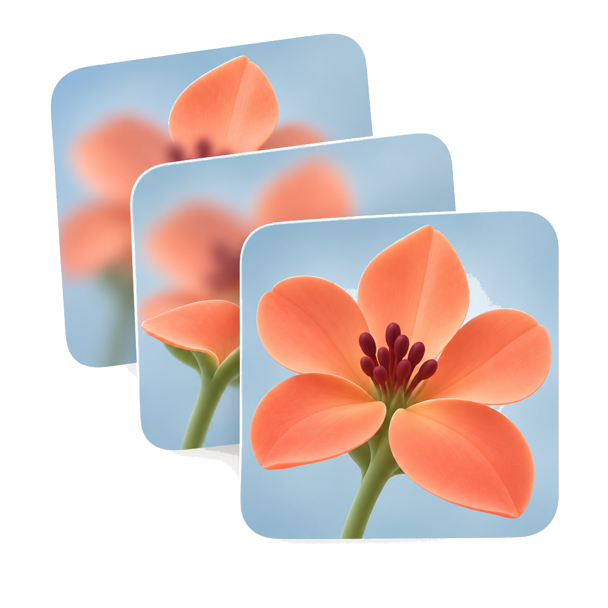
  </a>
</p>

<h1 align="center">OpenFocus</h1>

<p align="center"><strong>Cada pixel, do seu quadro mais nítido.</strong></p>

<p align="center">
  Dez algoritmos de fusão, cinco opções de alinhamento (incluindo nenhum) e um espaço de retoque vinculado à fonte para macro, microscopia e pilhas industriais. 16 bits de ponta a ponta, uma CLI sem interface gráfica e uma interface em doze idiomas.
</p>

<p align="center">
  <a href="https://github.com/Xinzhe99/OpenFocus/releases"></a>
  <a href="https://github.com/Xinzhe99/OpenFocus/stargazers"></a>
  <a href="../../docs/THIRD_PARTY_NOTICES.md"></a>
  
</p>

<p align="center">
  
  
  
  <a href="https://pypi.org/project/openfocus/"></a>
</p>

<p align="center">
  <a href="#install">Baixar</a> ·
  <a href="../USER_MANUAL_PT.md">Documentação</a> ·
  <a href="../../CHANGELOG.md">Alterações</a> ·
  <a href="https://doi.org/10.5281/zenodo.23050823">DOI</a>
</p>

<p align="center">
  <a href="../../README.md">English</a> ·
  <a href="README.zh-CN.md">简体中文</a> ·
  <a href="README.ja.md">日本語</a> ·
  <a href="README.es.md">Español</a> ·
  <a href="README.de.md">Deutsch</a> ·
  <a href="README.fr.md">Français</a> ·
  <a href="README.ru.md">Русский</a> ·
  <a href="README.ko.md">한국어</a> ·
  <strong>Português</strong> ·
  <a href="README.it.md">Italiano</a> ·
  <a href="README.nl.md">Nederlands</a> ·
  <a href="README.pl.md">Polski</a>
</p>

<p align="center">
  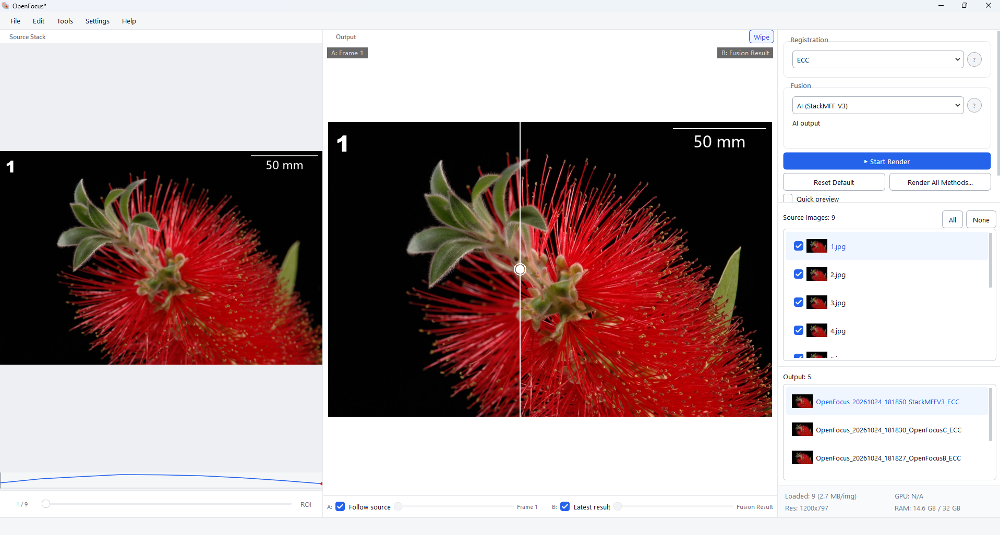
</p>

## 📢 Novidades

> [!NOTE]
> **v1.75.0** — Fusão agrupada, fluxos de processamento reutilizáveis, pilhas PNG transparentes, diagnóstico de alinhamento, exportações de profundidade aprimoradas e fluxo de desktop renovado. Consulte o registro de alterações para entradas suportadas e limitações.

As versões anteriores estão no [registro de alterações](../../CHANGELOG.md).

📸 Se você publicar imagens criadas com o OpenFocus, considere adicionar uma nota como:

> Criado com OpenFocus — https://github.com/Xinzhe99/OpenFocus

Não é obrigatório, mas é muito apreciado.

<a id="features"></a>
## Recursos

<table>
<tr>
<td width="46%" valign="middle">

### Fusão por IA: StackMFF V3

O StackMFF V3 usa IA para combinar as partes nítidas dos quadros de uma pilha.

[StackMFF V3 →](https://github.com/Xinzhe99/StackMFF-V3) · [Benchmark →](../../tools/synthetic_benchmark.py)

</td>
<td width="54%">

<a href="../../assets/readme/ai.mp4"><picture><source srcset="../../assets/readme/ai.gif" type="image/gif">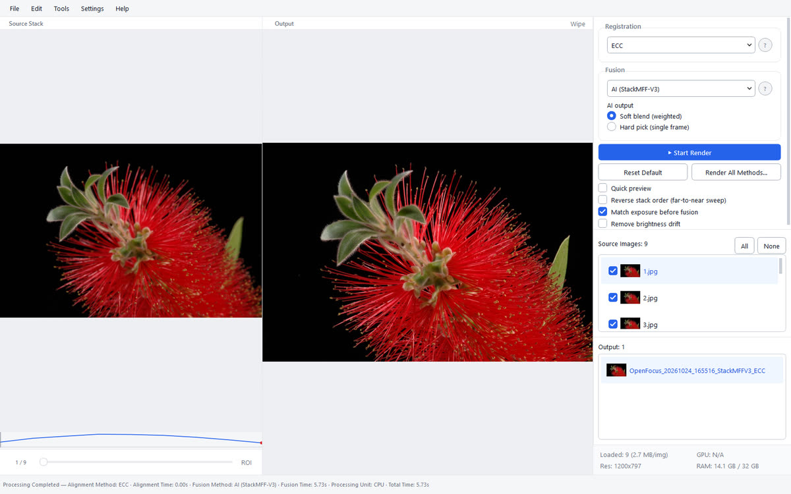</picture></a>

</td>
</tr>
<tr>
<td width="46%" valign="middle">

### Comparação cortina

Arraste o divisor para comparar um quadro de origem com o resultado fundido.

[Manual →](../USER_MANUAL_PT.md)

</td>
<td width="54%">

<a href="../../assets/readme/wipe.mp4"><picture><source srcset="../../assets/readme/wipe.gif" type="image/gif">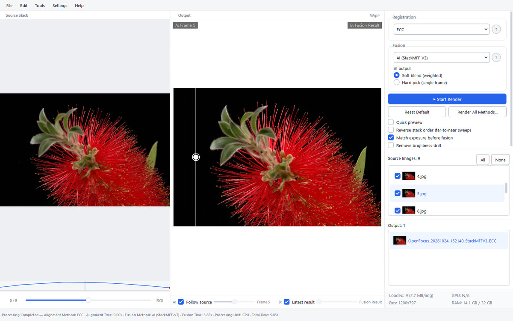</picture></a>

</td>
</tr>
<tr>
<td width="46%" valign="middle">

### Comparação de métodos

Compare os métodos lado a lado e reutilize o resultado ou as configurações escolhidas.

</td>
<td width="54%">

<a href="../../assets/readme/method-comparison.mp4"><picture><source srcset="../../assets/readme/method-comparison.gif" type="image/gif">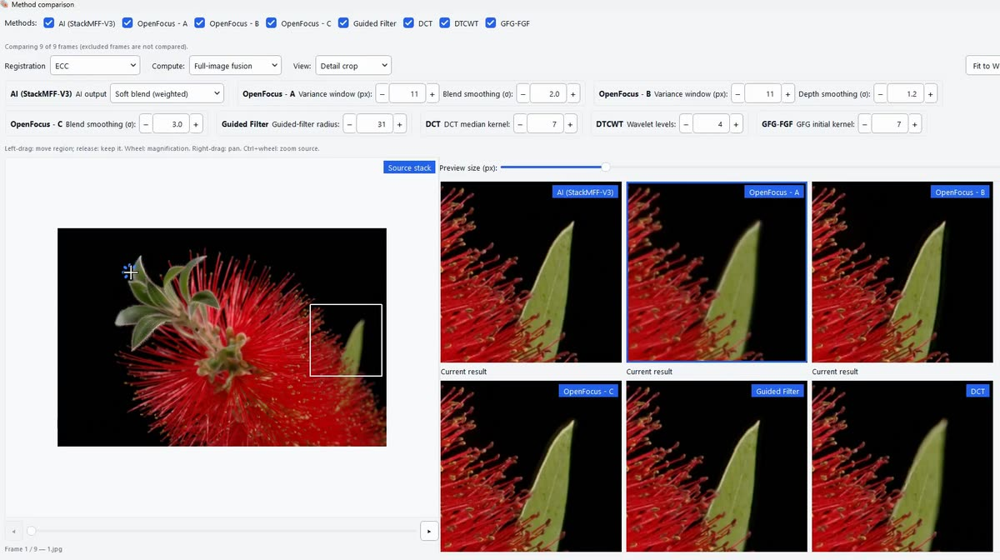</picture></a>

</td>
</tr>
<tr>
<td width="46%" valign="middle">

### Mapa de profundidade e 3D

Crie um mapa de profundidade e exporte uma superfície 3D texturizada.

</td>
<td width="54%">

<a href="../../assets/readme/depth.mp4"><picture><source srcset="../../assets/readme/depth.gif" type="image/gif">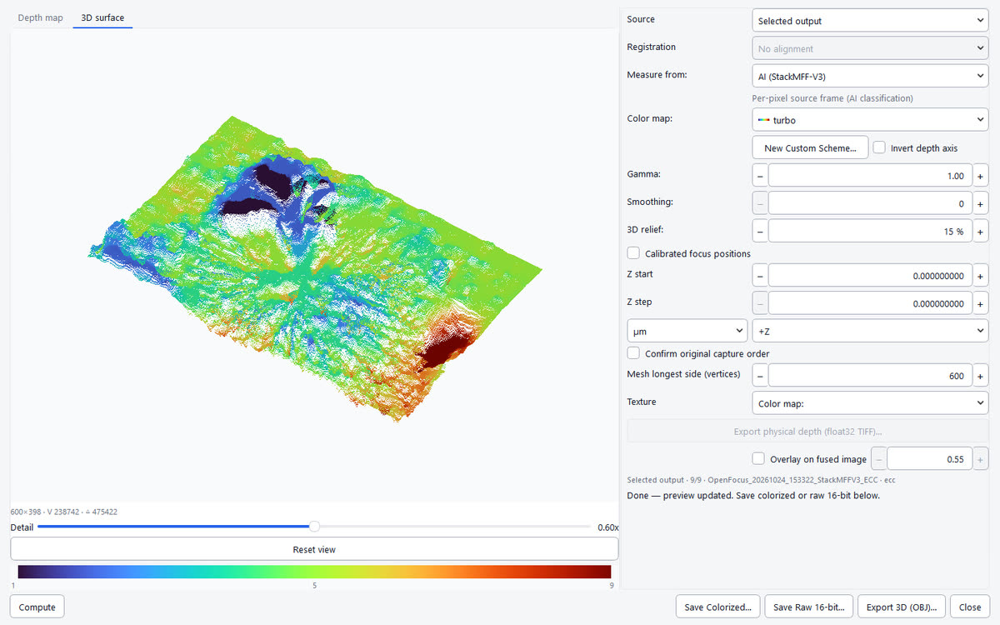</picture></a>

</td>
</tr>
<tr>
<td width="46%" valign="middle">

### Retoque vinculado à fonte

Retoque o resultado pintando a partir dos quadros de origem e exporte-o com eles em um TIFF em camadas. O fundo automático substitui um fundo empilhado irregular por um fotograma real.

</td>
<td width="54%">

<a href="../../assets/readme/retouch.mp4"><picture><source srcset="../../assets/readme/retouch.gif" type="image/gif">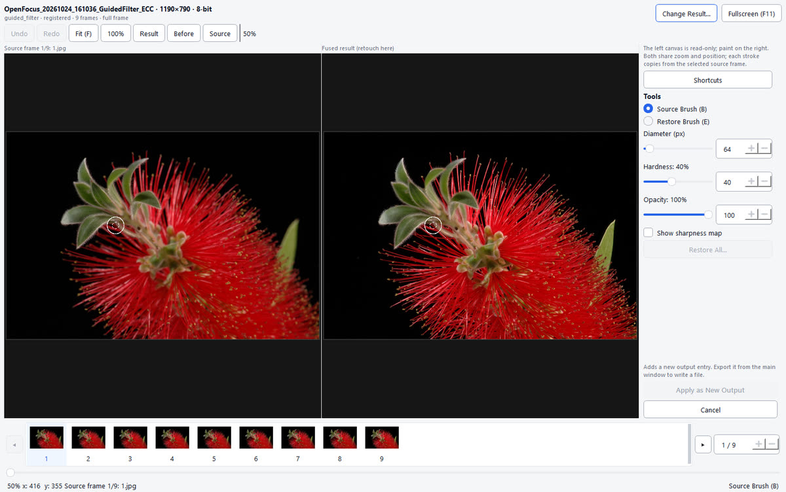</picture></a>

</td>
</tr>
<tr>
<td width="46%" valign="middle">

### Processamento em lote

Processe várias pilhas de uma vez, com fusão agrupada opcional para limitar a memória e o espaço temporário.

</td>
<td width="54%">

<a href="../../assets/readme/batch.mp4"><picture><source srcset="../../assets/readme/batch.gif" type="image/gif">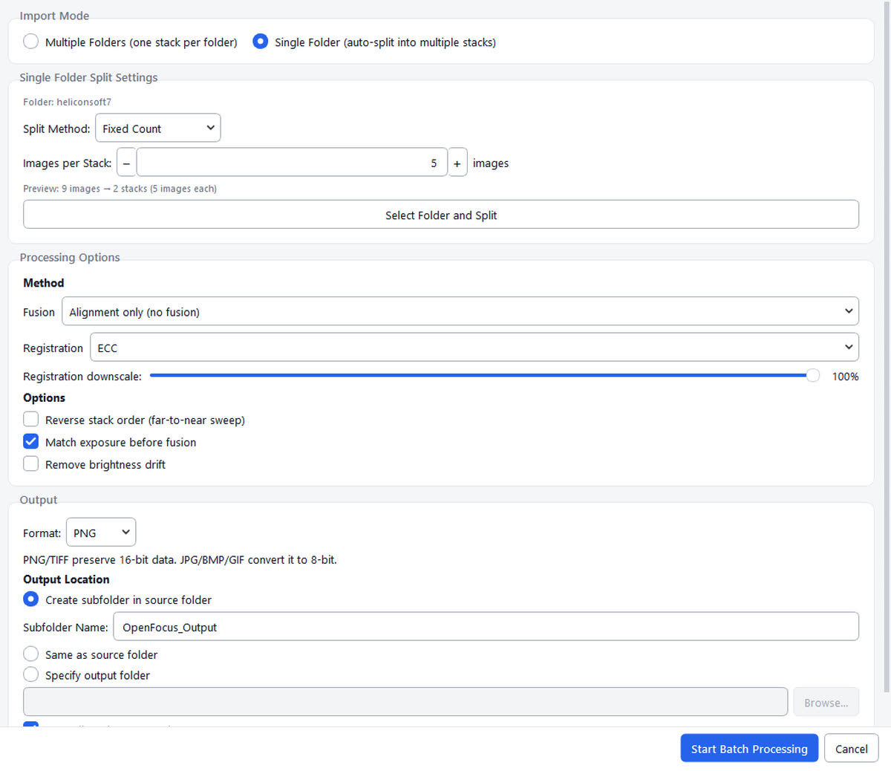</picture></a>

</td>
</tr>
<tr>
<td width="46%" valign="middle">

### Barras de escala para publicação

Adicione barras de escala calibradas por metadados TIFF ou inseridas manualmente.

[Manual →](../USER_MANUAL_PT.md)

</td>
<td width="54%">

<a href="../../assets/readme/scalebar.mp4"><picture><source srcset="../../assets/readme/scalebar.gif" type="image/gif">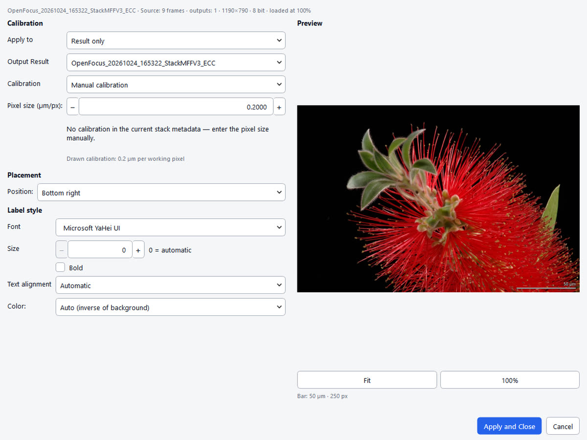</picture></a>

</td>
</tr>
<tr>
<td width="46%" valign="middle">

### Rótulos e legendas

Adicione rótulos e legendas com escopo, intervalo de quadros e estilo definidos.

</td>
<td width="54%">

<a href="../../assets/readme/labels.mp4"><picture><source srcset="../../assets/readme/labels.gif" type="image/gif">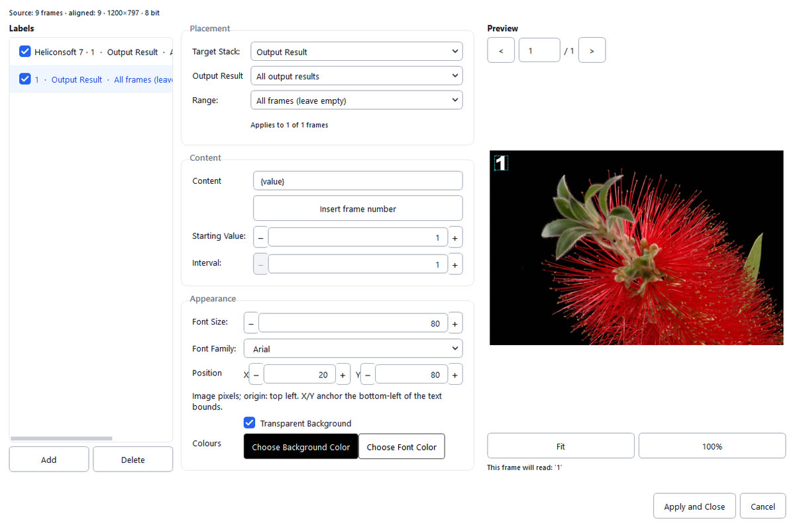</picture></a>

</td>
</tr>
<tr>
<td width="46%" valign="middle">

### Controlável por agente

Um agente pode controlar o aplicativo por um canal local protegido por token.

[Protocolo →](../AGENT_CONTROL_SPEC.md) · [Skill →](../../skills/openfocus-control/SKILL.md)

</td>
<td width="54%">

<a href="../../assets/readme/agent.mp4"><picture><source srcset="../../assets/readme/agent.gif" type="image/gif">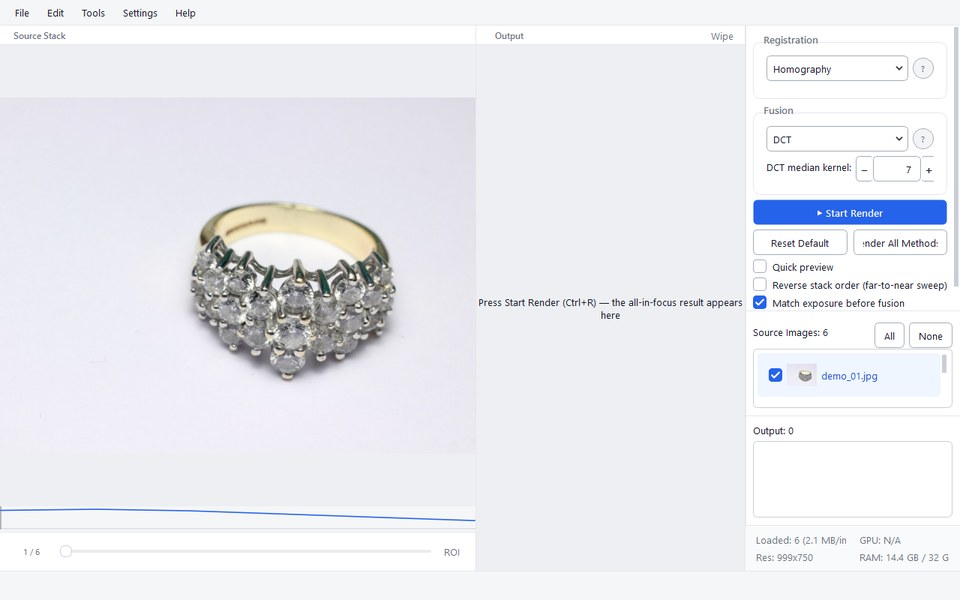</picture></a>

</td>
</tr>
</table>

**Também incluído:**

- **Focus stacking** — navegador de pilhas, curva de nitidez, prévia, render por ROI e ajustes salvos.
- **Microscopia** — 16 bits, calibração TIFF, correção de campo plano e pilhas Z TIFF multipágina.
- **Perfis de cor** — preserva o perfil ICC RGB comum nas exportações individuais compatíveis.
- **PNG transparente** — fusão de pilhas com máscaras retangulares compatíveis; consulte as restrições no manual.
- **CLI sem interface** — lotes, `--dry-run`, `--resume` e saída JSON com `openfocus`.
- **Projetos e recuperação** — sessões `.ofproj`, recuperação automática e desfazer/refazer.
- **Doze idiomas** — detecção automática e inclusão por arquivo `locales/<code>.py`.
- **Memória** — a rede neural só é carregada ao usar o método de IA.

<a id="install"></a>
## ⬇️ Instalação

Baixe a compilação mais recente para Windows ou macOS no [site do OpenFocus](https://openfocus.top/#download). Os mesmos arquivos e versões anteriores também estão no [GitHub Releases](https://github.com/Xinzhe99/OpenFocus/releases).

Consulte o [manual](../USER_MANUAL_PT.md) para instalação e solução de problemas.

No macOS com Apple Silicon ou no Linux, instale pelo terminal; no Linux, instala-se a CLI sem interface e, no macOS, o aplicativo fica em `~/Applications`:

```bash
curl -fsSL https://openfocus.top/install.sh | sh -s -- --dry-run # opcional: prévia
curl -fsSL https://openfocus.top/install.sh | sh
```

No Windows, execute o instalador pelo PowerShell:

```powershell
irm https://openfocus.top/install.ps1 | iex
```

Download direto do instalador do Windows:

```powershell
curl.exe -fL https://openfocus.top/download/latest/windows-setup -o OpenFocus-setup.exe
```

### 🤖 Integração com agentes

O aplicativo de desktop inicia automaticamente um canal local de agente protegido por token. Use `openfocus ctl` para comandos tipados ou ações genéricas de interface na janela ao vivo. Agentes podem carregar pilhas, renderizar, exportar, abrir e preencher diálogos, responder a seletores de arquivos, enviar eventos de mouse e teclado e tirar capturas de tela.

- Skill: [`skills/openfocus-control/SKILL.md`](../../skills/openfocus-control/SKILL.md)
- Protocolo e referência de comandos: [`docs/AGENT_CONTROL_SPEC.md`](../AGENT_CONTROL_SPEC.md)
- Executor de ponta a ponta: `python tools/agent_gui_smoke.py --launch`
- Varredura de todas as ações: `python tools/agent_action_sweep.py --launch`

### 💻 Uso pela linha de comando

Você também pode instalar a CLI no Windows, macOS e Linux — o mesmo pipeline, sem a pilha gráfica:

```bash
pip install openfocus
openfocus -i ./stack_folder -o ./result/fused.png
```

Consulte o [manual da CLI](../USER_MANUAL_PT.md#14-interface-de-linha-de-comando).

<a id="community"></a>
## Comunidade e suporte

Dúvidas, ideias ou sugestões? Participe da nossa [comunidade no Discord](https://discord.gg/afzmwgPt). Respondemos assim que possível; usamos o horário de Pequim (UTC+8), então a diferença de fuso pode afetar o tempo de resposta.

- **Documentação** — [Manual](../USER_MANUAL_PT.md) (doze idiomas) · [Alterações](../../CHANGELOG.md) · [Desempenho](../PERFORMANCE.md) · [Métodos de fusão](../FUSION_METHODS.md)
- **Citação** — [CITATION.cff](../../CITATION.cff); cada versão é arquivada no Zenodo ([DOI](https://doi.org/10.5281/zenodo.23050823))
- **Feedback** — abra uma [issue](https://github.com/Xinzhe99/OpenFocus/issues) para bugs, ideias e trabalho nos algoritmos
- **Créditos** — cada algoritmo de fusão e registro mantém sua licença de pesquisa original; o StackMFF V3 fica em [Xinzhe99/StackMFF-V3](https://github.com/Xinzhe99/StackMFF-V3)

<a id="license"></a>
## Licença

O aplicativo OpenFocus é distribuído sob a [licença MIT](../../LICENSE).

**Licenças StackMFF.** Os novos pesos e wrappers V1/V2 estão sujeitos à StackMFF V3 License 1.0. Copiar, distribuir, incorporar em outros projetos ou usar comercialmente exige permissão prévia por escrito do titular dos direitos. O snapshot v2.0 original do StackMFF V3 incluído no projeto continua sob licença MIT. Consulte os [avisos de terceiros](../../docs/THIRD_PARTY_NOTICES.md).

<a id="developing"></a>
## Desenvolvimento

Executar a partir de um clone:

```bash
conda create -n openfocus python=3.10
conda activate openfocus
pip install -r requirements.txt
python main.py
```

Empacotamento com PyInstaller: [docs/BUILD_COMMANDS.md](../BUILD_COMMANDS.md).

Adicionar um algoritmo de fusão ou registro: [CONTRIBUTING.md](../../CONTRIBUTING.md).
A [especificação de extensibilidade](../ALGORITHM_EXTENSIBILITY_SPEC.md) define os contratos compartilhados de registro, parâmetros, execução e persistência.

<a id="star-history"></a>
## ⭐ Histórico de estrelas

[](https://star-history.com/#Xinzhe99/OpenFocus&Date)
